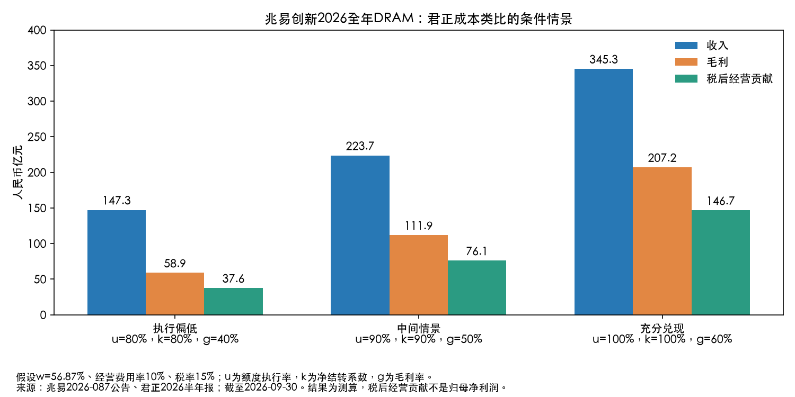

# 兆易创新2026全年DRAM：采用君正晶圆成本比例的条件测算

研究截至2026-09-30，金额为人民币亿元。专项情景分析，不是公司指引或已披露分部业绩。

## 结论

**若按君正56.87%的晶圆成本占比，同时假设兆易年度关联采购额度执行90%、净结转系数90%、DRAM毛利率50%，可以推导2026全年DRAM收入约223.7亿元、毛利约111.9亿元、税后经营贡献约76.1亿元。**最后一项另假设经营费用率10%、税率15%，不是归母净利润。

这是一组可复算的条件结果，不能仅由采购额度和成本占比证明。用较低执行/结转及40%毛利率，收入约147.3亿元；用全额执行/结转及60%毛利率，约345.3亿元。两端是参数情景，不是统计置信区间，也不是市场预测区间。

## 事实底数与类比边界

- 兆易2026-087公告：拟将全年向长鑫集团自有品牌DRAM相关采购、代工额度由57.11亿元上调至78.54亿元；1—8月实际35.96亿元，均不含税。增加原因主要为代工价格随市场上涨。新增额度截至研究日尚待股东会审批，不是已实现成本。
- 君正2026H1存储芯片晶圆成本7.77亿元、存储营业成本13.67亿元，占比56.87%；2025全年55%。上述是DRAM、SRAM、Flash混合业务的数据，不是纯DRAM成本比。
- 兆易公告说的是DRAM相关采购、代工，没有披露可核实的“纯晶圆”金额拆分。下面暂假设全部采购都能映射到君正的晶圆成本项；如果采购中已经包含封测或其他成本，再全部除以56.87%会重复放大完整成本和收入。
- 不额外计入其他供应商采购；若存在且不在额度内，完整DRAM预测还需补充。不能把长鑫自身的收入利润并入兆易。

## 公式：先从采购桥接销售成本，再推收入

设A=78.54，u为额度执行率，k为年度净结转系数，w为晶圆成本/完整营业成本，g为DRAM毛利率。

**晶圆销售成本W=A×u×k；完整营业成本C=W÷w；收入R=C÷(1−g)；毛利G=R−C。**

净结转系数k定义为“全年已销售产品中晶圆成本÷当年晶圆对应采购额”，综合期初库存释放及期末留存影响。不是只看本年新采购售出比例，也不代表期初库存为零；消化期初库存时k可以大于100%。本情景暂取80%—100%，并无公告直接支持这些数值。

税后经营贡献=(毛利−收入×10%)×(1−15%)。不含财务收支、投资收益、政府补助、减值和少数股东分摊等；没有DRAM独立费用与税率披露，所以不能命名为DRAM已确认净利润或归母贡献。

| 情景 | 额度执行率u | 净结转系数k | 毛利率g | 收入 | 毛利 | 税后经营贡献 |
| --- | --- | --- | --- | --- | --- | --- |
| 执行偏低 | 80% | 80% | 40% | 147.31 | 58.92 | 37.56 |
| 中间情景 | 90% | 90% | 50% | 223.73 | 111.86 | 76.07 |
| 充分兑现 | 100% | 100% | 60% | 345.26 | 207.16 | 146.74 |

固定w=56.87%，费用率10%，税率15%。所有表内结果为测算，参数为假设。毛利率并非兆易披露值，40%/50%/60%只是敏感性档位，不能把集团存储大类毛利率等同DRAM毛利率。

## 中间情景逐步复算

1. 年度采购：78.54×90%=70.686。
2. 对应全年已结转晶圆成本：70.686×90%=63.6174。
3. 补足封装、测试、其他成本：63.6174÷56.87%=111.8646。
4. 假设毛利率50%，收入=111.8646÷50%=223.7292；毛利相同。
5. 扣收入10%的经营费用及15%所得税，得到税后经营贡献76.0679。

如果把君正48.07%的存储毛利率也完全照搬，并假设78.54亿元全部采购、净结转系数100%，则收入约265.94、毛利127.84、税后经营贡献86.06。这是“双重类比+充分结转”的机械演示，不能比中间情景获得更高置信度。

## 相比此前模型为什么明显变大

此前专项报告暂设w=90%，并非公司披露。保持u=k=90%、g=50%、费用率10%、税率15%不变，改用君正w=56.87%，收入从141.37变为223.73亿元，上升约58.26%。这主要是完整成本分母假设改变，并不是发现了新的订单或售价，不能称为确定性业绩上调。

| 晶圆占完整成本假设 | 收入 | 毛利 | 税后经营贡献 |
| --- | --- | --- | --- |
| 55.00% | 231.34 | 115.67 | 78.65 |
| 56.87% | 223.73 | 111.86 | 76.07 |
| 70.00% | 181.76 | 90.88 | 61.80 |
| 90.00% | 141.37 | 70.69 | 48.07 |

当已知晶圆采购金额、假定毛利率不变时，晶圆成本占比越低，意味着反推的封测及其他成本越大，再反推出更大的收入。这是反推模型的数学性质，**不是成本越高、盈利能力越强**。若售价和销量已确定，应改为正向计算成本与毛利，而不能同时固定高毛利率让收入自动增加。

## 与已发生交易、半年业绩交叉检查

- 中间情景全年采购70.686亿元，扣除1—8月35.96亿元，后四个月还需34.726亿元、月均8.68亿元，比前八个月4.495亿元高约93.1%。充分执行情景后四个月月均10.645亿元，高136.8%。因此中间情景也要求后期采购金额显著加速；涨价、交付节奏与备货均可能影响执行，并不意味着同幅度量增。
- 兆易2026H1全部存储收入约98.27亿元，包含NOR、NAND与DRAM。若全年DRAM达到中间情景约224亿元，因H1 DRAM小于全部存储98.27亿元，H2 DRAM收入必须大于约125.46亿元；若H1实际DRAM较小，H2要求更高。现有分类披露不能证明这一销售规模能实现。
- 完整预测需要DRAM独立销量、ASP、存货成本、全年采购执行及独立毛利率。当前可识别的是条件规模，不能据此认定兆易DRAM真实收入就在147—345亿元之间，也不宜单独把76亿元税后经营贡献加到其他业务利润上形成集团目标。

## 最值得核验的三个参数

第一，长鑫交易中纯晶圆成本比例，以及是否已包含封测。第二，采购何时销售并结转，有多少留在年末库存。第三，DRAM实际毛利率及费用负担。君正55%—57%的历史波动只造成几个百分点的结果变化；跨公司口径和毛利率假设可以造成远更大的误差。

## 来源和复算

- [兆易2026-087公告原文转载](https://www.cfi.net.cn/p20260928001427.html)，披露日2026-09-29，已保存于[原始资料](原始资料/2026-09-29关联交易/2026-087公告_中财网转载.html)。
- [兆易2026半年报](https://static.cninfo.com.cn/finalpage/2026-08-19/1225480384.PDF)，经营讨论及分产品收入成本；本项目既有年度报告引用第134页。
- [君正2026半年报第21页](https://disc.static.szse.cn/disc/disk03/finalpage/2026-08-29/e014eec0-17cd-4ead-b70b-c18248367e7a.PDF)；原始PDF及晶圆成本底表位于君正股份文件夹。
- [本次输入和测算](原始数据/君正类比DRAM情景.json)、[生成脚本](原始数据/君正类比DRAM测算.py)。旧报告保留原假设，本篇为替换w参数后的新增情景。
