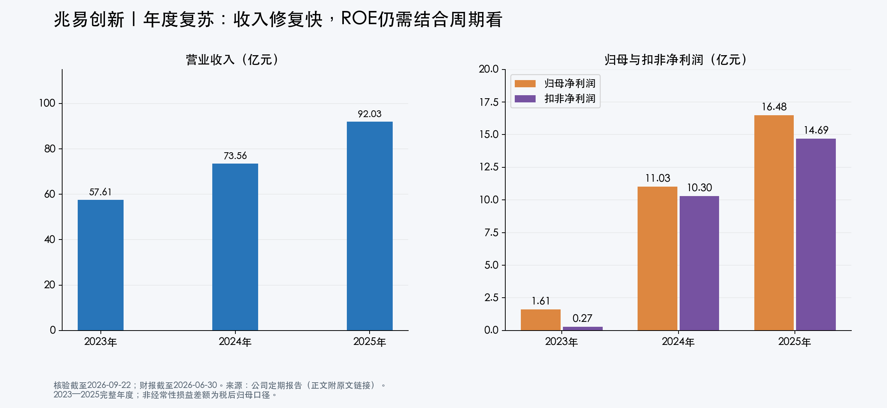
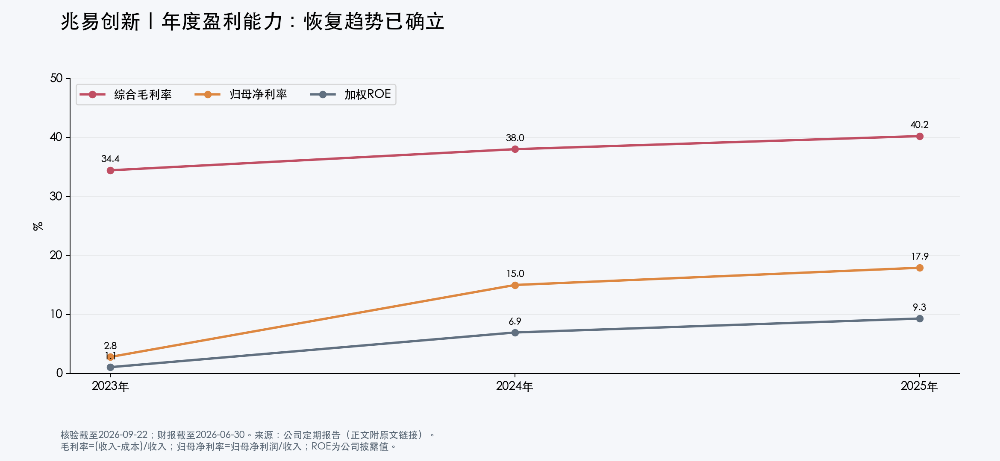
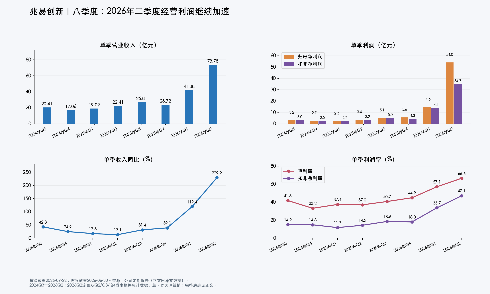
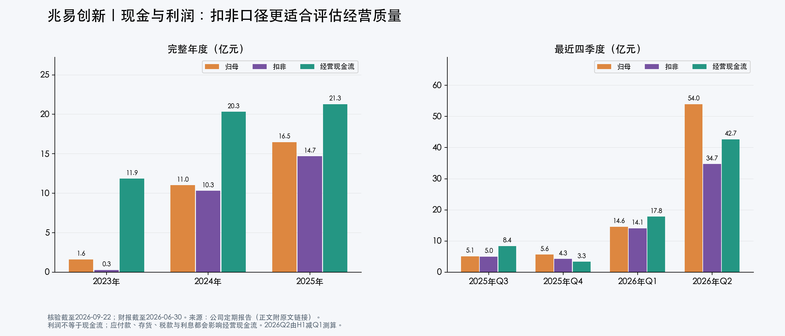
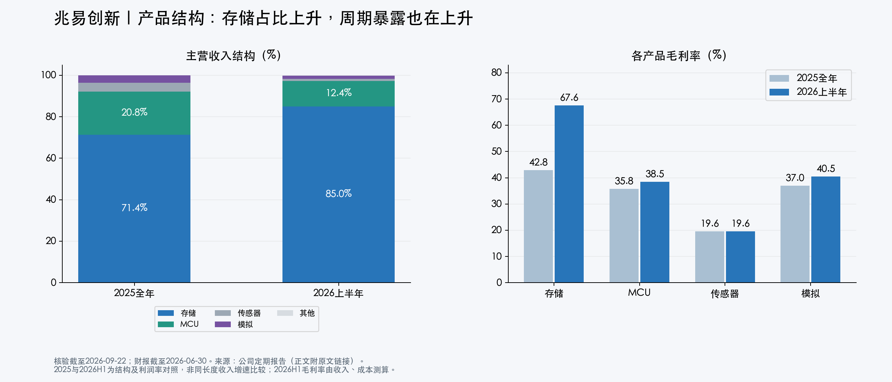

# 兆易创新：年度与八季度财报复核

研究日：2026-09-22。完整年度：2023—2025；最新财报：2026H1；重点季度：2024Q3—2026Q2。金额为人民币亿元，表内保留两位小数，计算使用未取整原数。以合并报表为准。本文替代2026-09-21版财报结论。

## 结论

**经营趋势偏强，但仍需按有周期性的芯片设计公司估值。** 2026Q2收入环比增长76.16%，扣非归母利润环比增长146.30%，综合毛利率升至66.57%。经营改善已在单季数据中兑现，尚无财务证据证明业绩见顶；同时，这种利润率对存储供求非常敏感，不能将高增长直接外推数年。

相比旧版，补齐季度和扣非口径后，判断有三点变化：经营加速比半年累计增速更明显；投资收益主要集中于二季度；存货和应收余额上升尚未表现为周转恶化。下一个验证点是三季度扣非利润与毛利率的环比变化。

## 一、年度：走出低谷，但历史高增速不等于稳定复利

| 指标 | 2023年 | 2024年 | 2025年 | 2026H1（仅半年） |
|---|---:|---:|---:|---:|
| 营业收入 | 57.61 | 73.56 | 92.03 | 115.66 |
| 归母净利润 | 1.61 | 11.03 | 16.48 | 68.57 |
| 扣非归母净利润 | 0.27 | 10.30 | 14.69 | 48.83 |
| 营业成本 | 37.78 | 45.61 | 55.02 | 42.64 |
| 综合毛利率（测算） | 34.42% | 38.00% | 40.22% | 63.13% |
| 归母净利率（测算） | 2.80% | 14.99% | 17.91% | 59.29% |
| 扣非净利率（测算） | 0.48% | 14.01% | 15.96% | 42.22% |
| 加权平均ROE | 1.06% | 6.94% | 9.30% | 23.13%（未年化） |
| 经营现金流净额 | 11.87 | 20.32 | 21.29 | 60.48 |
| 研发投入（费用化+资本化） | 10.67 | 12.56 | 14.04 | 约9.66 |
| 其中费用化研发 | 9.90 | 11.22 | 11.17 | 7.65 |
| 研发资本化比例 | 7.23% | 10.65% | 20.45% | 约20.8%（测算） |
| 期末存货净额 | 19.91 | 23.46 | 30.66 | 41.84 |
| 期末应收账款净额 | 1.14 | 2.12 | 1.93 | 4.36 |
| 期末资产负债率 | 7.63% | 13.26% | 10.16% | 约11.5% |

来源：[2025年报，第7—8、16、21、87页](https://static.cninfo.com.cn/finalpage/2026-03-31/1225061352.PDF)、[2024年报，第20、94—95页](https://static.cninfo.com.cn/finalpage/2025-04-26/1223305062.PDF)、[2023年报研发投入表](https://vip.stock.finance.sina.com.cn/corp/view/vCB_AllBulletinDetail.php?id=10007264)、[2026半年报，第6、12—14、24页](https://static.cninfo.com.cn/finalpage/2026-08-19/1225480384.PDF)。半年数不与全年数直接计算同比，资产负债率按总负债/总资产计算；净利率统一用归母口径。

趋势事实：2023—2025年收入年复合增长约26.4%，毛利率温和修复；2023年扣非利润接近零，随后利润的倍数增长受低基数影响很大。2023年还发生商誉减值，因此不能拿该年作为正常盈利基准。

分析判断：2025年ROE为9.30%，尚不足以单凭历史资本回报证明长期高估值合理。2026H1 ROE跳升同时受到盈利、募资及其他综合收益变化影响，半年ROE也不能与全年直接对比。更值得关注的是扣非盈利能否跨周期维持。

## 二、季度：2025Q4与2026Q2呈现两种不同的利润增长

### 单季度底表

| 季度 | 收入 | 归母净利润 | 扣非净利润 | 营业成本* | 毛利率* | 经营现金流 |
|---|---:|---:|---:|---:|---:|---:|
| 2024Q3 | 20.41 | 3.15 | 3.04 | 11.88 | 41.77% | 6.08 |
| 2024Q4 | 17.06 | 2.70 | 2.53 | 11.40 | 33.17% | 1.75 |
| 2025Q1 | 19.09 | 2.35 | 2.24 | 11.94 | 37.44% | 3.36 |
| 2025Q2 | 22.41 | 3.41 | 3.21 | 14.12 | 37.01% | 6.22 |
| 2025Q3 | 26.81 | 5.08 | 4.98 | 15.89 | 40.72% | 8.38 |
| 2025Q4 | 23.72 | 5.65 | 4.27 | 13.07 | 44.91% | 3.33 |
| 2026Q1 | 41.88 | 14.61 | 14.10 | 17.98 | 57.08% | 17.83 |
| 2026Q2* | 73.78 | 53.96 | 34.73 | 24.67 | 66.57% | 42.65 |

*测算说明：2024及2025年单季收入、利润、现金流直接取年报分季度表；2026Q1直接取季报；2026Q2所有流量数据=2026H1累计−Q1。Q2/Q3/Q4营业成本由同年累计成本差分测算；Q1成本直接披露。所有单季毛利率均为测算值，公式为1−单季营业成本/单季收入，**不能用累计毛利率直接相减**。以上差分仅适用于流量，存货、应收等余额不作季度相减。增长率也均为测算值。

### 收入与利润增长

| 季度 | 收入同比 | 收入环比 | 归母同比 | 归母环比 | 扣非同比 | 扣非环比 |
|---|---:|---:|---:|---:|---:|---:|
| 2024Q3 | 42.83% | 2.97% | 222.55% | 0.93% | 367.35% | 4.94% |
| 2024Q4 | 24.89% | -16.38% | 扭亏 | -14.18% | 扭亏 | -16.78% |
| 2025Q1 | 17.32% | 11.88% | 14.57% | -13.24% | 21.83% | -11.52% |
| 2025Q2 | 13.09% | 17.40% | 9.17% | 45.27% | 10.66% | 43.21% |
| 2025Q3 | 31.40% | 19.64% | 61.13% | 48.97% | 63.71% | 55.25% |
| 2025Q4 | 39.00% | -11.54% | 108.85% | 11.23% | 68.79% | -14.19% |
| 2026Q1 | 119.38% | 76.58% | 522.79% | 158.72% | 529.90% | 230.18% |
| 2026Q2 | 229.18% | 76.16% | 1482.99% | 269.24% | 983.35% | 146.30% |

同比基期利润为负时以“扭亏”表达；环比受季节性影响，不能单独定性景气。用于增长计算的补充基期如下：

| 基期 | 收入 | 归母 | 扣非 |
|---|---:|---:|---:|
| 2023Q3 | 14.29 | 0.98 | 0.65 |
| 2023Q4 | 13.66 | -2.73 | -3.13 |
| 2024Q1 | 16.27 | 2.05 | 1.84 |
| 2024Q2 | 19.82 | 3.12 | 2.90 |

单季来源：[2023年报分季度表](https://vip.stock.finance.sina.com.cn/corp/view/vCB_AllBulletinDetail.php?id=10007264)、[2024年报第8页](https://static.cninfo.com.cn/finalpage/2025-04-26/1223305062.PDF)、[2025年报第8页](https://static.cninfo.com.cn/finalpage/2026-03-31/1225061352.PDF)、[2026Q1第1、8页](https://static.cninfo.com.cn/finalpage/2026-04-30/1225257883.PDF)、[2026H1第6、13页](https://static.cninfo.com.cn/finalpage/2026-08-19/1225480384.PDF)。成本差分另使用[2024H1合并利润表](https://vip.stock.finance.sina.com.cn/corp/view/vCB_AllBulletinDetail.php?id=10390175&stockid=603986)及[2025Q3合并利润表中的2024/2025年累计成本](https://money.finance.sina.com.cn/corp/view/vCB_AllBulletinDetail.php?id=11551919&stockid=603986)。

读图重点：

1. **2025Q4有盈利质量分化。** 归母利润环比上升11.23%，扣非却下降14.19%；两者差额由Q3的0.10亿元扩大到Q4的1.38亿元。尽管毛利率改善，收入下滑和非经常性项目使归母增速无法代表主营增速。
2. **2026Q1是明显加速点，Q2继续加速。** Q2收入增加31.90亿元，营业成本只增加6.69亿元，毛利额增加约25.21亿元；毛利率环比提升9.49个百分点。毛利扩张可以解释很大一部分扣非利润增加，但报告未提供足够的单季销量、均价数据，不能精确拆成多少来自涨价、多少来自出货。
3. **2026Q2利润同时受到投资重估放大。** 归母53.96亿元、扣非34.73亿元，差额19.23亿元，占当季归母约35.6%。这既不能全部当成经常性利润，也不能因此否定扣非利润本身的强增长。

## 三、现金流与营运资金：经营改善有支持，但现金流不是“利润质量证明书”

2025年经营现金流/归母利润约1.29倍；2026H1约0.88倍、经营现金流/扣非利润约1.24倍。二季度单季经营现金流42.65亿元，比扣非利润34.73亿元高。投资浮盈不带来同额现金，因此与扣非对照更有意义。

同时，2026H1应付账款从8.13亿元升至16.49亿元，增加8.36亿元，会改善营运资金现金流；库存增加、应收增加则反向占用现金。经营现金流还受税费、薪酬、利息和预付款影响，不能仅凭现金流大于利润就宣称全部利润已收现。

| 指标（测算） | 2024全年 | 2025全年 | 2026H1 |
|---|---:|---:|---:|
| 存货周转天数 | 173.6天 | 179.5天 | 153.9天 |
| 应收账款周转天数 | — | 8.0天 | 4.9天 |

公式：存货周转天数=(期初+期末存货净额)/2÷期间成本×期间天数；应收周转用相同平均余额法除以期间收入。全年统一按365天标准，2026H1按181天；使用期初期末均值而非月度均值，为粗略测算。未包含应收票据、渠道库存，也会受涨价和减值影响。

分析判断：存货绝对值增长需要关注，但上述周转指标尚未指向库存积压恶化。上一版将期末较年初增长与收入同比混看，证据不充分。下一步真正的警报是：售价回落、出货放缓，同时存货周转天数连续上升。

研发投入的质量也要追踪：2025年资本化比例20.45%，高于2023年的7.23%。资本化符合会计条件不等于有问题，但会使费用化研发增长低于实际投入增长，并在以后产生摊销或减值。以“研发费用微降”判断降本提效并不充分。

## 四、业务结构：增长主要来自存储，MCU提供另一条成长路径

| 产品 | 2025收入 | 2025毛利率 | 2026H1收入 | 2026H1毛利率* |
|---|---:|---:|---:|---:|
| 存储芯片 | 65.66 | 42.84% | 98.27 | 67.57% |
| MCU | 19.10 | 35.82% | 14.30 | 38.49% |
| 传感器 | 3.89 | 19.57% | 1.00 | 19.60% |
| 模拟 | 3.33 | 36.96% | 1.91 | 40.50% |
| 技术服务及其他主营 | 0.04 | 87.68% | 0.18 | 78.84% |

*2026H1按分产品收入和成本计算。2025表为主营分产品，微量其他业务导致与总收入略有差异。2024年MCU与模拟合并披露，不将其直接与2025年MCU单独口径计算增长。来源：[2025年报第17页](https://static.cninfo.com.cn/finalpage/2026-03-31/1225061352.PDF)、[2026半年报第134页](https://static.cninfo.com.cn/finalpage/2026-08-19/1225480384.PDF)。

事实：2026H1存储占主营收入约85.0%，高于2025年71.4%；MCU收入同比增长49.07%，但占比因存储增长更快而降低。公司没有披露足够详细的NOR、SLC NAND、DRAM独立利润数据，因此不能对三条产品线分别给出精确利润预测。分产品毛利也不是分产品净利润，尚未分配研发及管理费用。

判断：产品线越来越多，并没有使当期收益自动分散；目前存储周期依然主导利润。MCU的价值在于中长期客户和产品升级，不应因为占比下降就否定它的增长，也不应高估其当前对存储下行的对冲能力。

## 五、两种投资升值必须分开

| 项目 | 会计去向 | 投资判断含义 |
|---|---|---|
| 2026H1公允价值变动收益约22.28亿元 | 当期利润表，税前金额 | 税后归母影响不能直接用22.28亿元相减；直接使用扣非归母更清楚 |
| 长鑫科技股权公允价值上升 | 其他权益工具投资、其他综合收益及权益 | 本期升值没有直接进入归母净利润；不能把它当作上述22.28亿元的来源 |

半年归母减扣非的差额为19.74亿元，是税后归母非经常性损益净额。长鑫投资截至期末账面价值100.62亿元、持股约1.80%，属于另行评估的资产价值，不能与净利润估值重复相加。出处：[半年报第7、13、17—18、24页](https://static.cninfo.com.cn/finalpage/2026-08-19/1225480384.PDF)。

## 六、下一期如何验证

| 观察指标 | 支持经营延续 | 需要下调判断 |
|---|---|---|
| Q3扣非归母利润 | 接近或高于Q2的34.73亿元 | 明显下滑且无法由季节性、研发等解释 |
| 综合毛利率 | 在高位趋稳，销量仍增长 | 毛利率连续环比下降并伴随订单减弱 |
| 存货、应收周转 | 随规模扩张保持稳定 | 连续两个报告期恶化且现金流转弱 |
| 非经常性损益 | 核心利润支撑报表，投资收益单列 | 归母增长主要依靠新的投资浮盈 |
| 研发和新品 | 实际量产、收入、毛利可识别 | 资本化持续提升而量产兑现落后 |

以上是观察框架，不是公司指引或机械交易阈值。单季偏离需要结合价格、产品组合、采购成本和税率解释。

图表底层原数和计算逻辑保存在[生成图表.py](图表/生成图表.py)，同时提供PNG与SVG版本。已核对年度季度加总、2026H1差分与收入成本计算关系。
