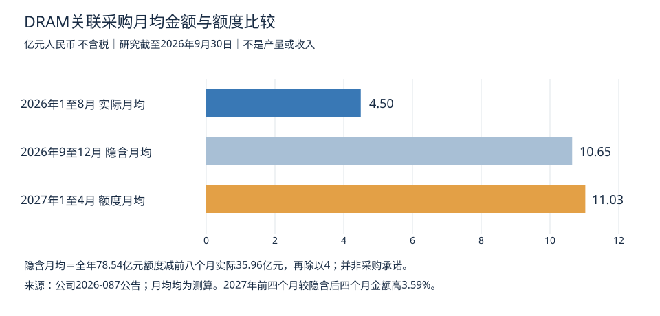

# 兆易创新关联交易与DRAM量价利润情景分析

研究截至2026年9月30日。本报告解读2026年9月29日公告2026-087，是专项前瞻测算，不替代本目录已有年度及八季度财报分析。金额均为人民币亿元、不含税。所有预测与敏感性参数均不是公司业绩指引。

## 核心判断

最新公告强化了DRAM高采购金额、高成本水平可能延续至2027年初的判断，但不能证明产量增加37.5%，也不能证明利润同步上调37.5%。对2026年本次修订，公司明确指出代工价格上涨；对2027年初，另外提及利基型DRAM及定制化存储新产品。

我的预期调整是：**收入名义规模的上行可能性增强，实物产量只作有条件上修，利润增速与毛利率需更谨慎。** 采购涨价已经披露，销售价格的跟涨幅度却未在本次公告量化。如果此前模型假设代工成本保持不变，应先修正这一假设，而不是把新增采购额度全部转成新增收入和利润。

## 公告事实和时间口径

| 项目 | 金额 | 属性 |
|---|---:|---|
| 2026年原年度预计额度 | 57.11 | 原预算额度 |
| 本次新增额度 | 21.43 | 拟上调额度 |
| 2026年调整后额度 | 78.54 | 拟批准的年度总额，不是实际采购 |
| 2026年1至8月实际发生额 | 35.96 | 已发生关联交易，不等同销售成本 |
| 2027年1至4月预计额度 | 44.11 | 四个月额度，不是全年指引 |

交易类别为向长鑫集团进行自有品牌DRAM相关采购、代工。截至研究日，本议案尚待股东会审议。[公告全文](https://www.cfi.net.cn/p20260928001427.html)；[法定信息披露平台刊载的公司公告](https://paper.cnstock.com/html/2026-09/29/content_2273241.htm)。

据上述数据计算：

- 年度额度上调比例：78.54÷57.11−1＝**37.52%**。
- 若全年用满额度，9至12月可发生金额：78.54−35.96＝**42.58亿元**。这不是公司单独公布的后四个月采购指引。
- 1至8月实际月均4.495亿元；9至12月用满额度所需月均10.645亿元，较前八个月月均高136.82%。该差异可能同时包含价格、交付节奏、备货和额度余量，不能等同产量增长。
- 2027年前四个月月均11.0275亿元，比上述2026年后四个月隐含月均仅高**3.59%**。
- 44.11×3＝132.33亿元，只是保持同一月均金额的全年机械年化值，比78.54亿元高68.49%，**不是2027年全年订单或盈利预测**。

图的关键不在于把前八个月与未来额度直接作同比，而是看到：若2026年底额度执行充分，2027年初更像高位延续，而非在年底基础上再次成倍扩张。不同柱子的实际值、额度值属性不能混淆。

## 产量只能在假设单位采购成本后推算

兆易创新为Fabless公司，这里的产量指委外获得的晶圆或可销售芯片产出，不是长鑫总产能。不能用采购金额直接估计兆易拥有多少晶圆厂产能，也不能把不同容量DRAM的颗数视作等量产品。

同一产品组合和计量口径下：

**新采购数量÷旧计划采购数量＝新额度÷旧额度×新执行率÷旧执行率÷单位采购成本变化倍数。**

进一步从采购数量推导合格芯片产量，还需良率、每片晶圆裸片数、容量结构和生产周期。公告未提供这些参数，所以不输出缺乏依据的月产晶圆片数或芯片颗数。

以下假定新旧额度执行率相同、产品结构不变，是相对原2026年计划的敏感性测算，不是同比预测：

| 单位采购成本较旧计划上涨 假设 | 对应采购数量较旧计划变化 测算 |
|---|---:|
| 0% | +37.52% |
| 20% | +14.60% |
| 30% | +5.79% |
| 37.52% | 约0% |
| 50% | −8.32% |

分析判断：公告明确强调代工涨价，因此把全部37.52%解读成量增没有证据。如果单位成本上调20%至30%，同执行率下数量只需要增加约6%至15%；但这个成本涨幅区间本身是假设，不能将约6%至15%当成已经证实的产量预测。

同理，2027年前四个月与2026年后四个月隐含预算相比，若单位采购成本继续涨10%，等执行率、等结构下数量反而约下降5.83%；若价格不变，数量约增加3.59%。这说明金额维持高位并不能保证实物产量增长。

## 收入测算必须处理库存和封测成本

关联采购金额不是DRAM营收，也不等于当期营业成本。采购后可能仍处于在制品、库存或封测环节；销售也可能消化上年低成本库存。

为看清量级，设以下纯假设模型：

- A为年度采购额度，u为实际执行率；
- s为该年度采购成本中，随产品在当年销售结转的比例；
- w为长鑫采购成本占对应产品完整营业成本的比例，剩余包括封测等；
- B为期初库存及其他来源产品形成的销售成本，本示例设为0，实际不能忽略；
- g为对应DRAM销售毛利率。

公式：**对应销售成本C＝A×u×s÷w＋B；对应收入R＝C÷（1−g）；毛利＝R−C。**

下面固定u＝90%、s＝90%、w＝90%、B＝0。这样78.54亿元额度对应采购70.686亿元，其中当年结转长鑫成本63.6174亿元，再补封测等成本，合计营业成本70.686亿元。该模型仅覆盖本年采购并在本年售出的产品，并非完整DRAM分部预测。毛利率40%、50%、60%为敏感性档位，未声称是公司披露值。

| 假设DRAM毛利率 | 对应收入 测算 | 对应毛利 测算 | 税后经营贡献 测算 |
|---|---:|---:|---:|
| 40% | 117.81 | 47.12 | 30.04 |
| 50% | 141.37 | 70.69 | 48.07 |
| 60% | 176.72 | 106.03 | 75.10 |

最后一列额外假定分摊经营费用为收入的10%、有效所得税率15%，公式为R×（g−10%）×85%。不包括投资损益、财务收支、减值及其他业务，也未处理少数股东分摊，**不是公司归母净利润**。

这张表回答的是“某种毛利率、执行率下可以支持多大规模”，不是“公告能证明117.81至176.72亿元收入”。尤其高毛利率要求销售端足够强，不能把毛利率作为一个已经确定的外生条件后，再宣称收入预测得到了验证。完整年度预测还须补期初DRAM库存及其结转、采购单位价格、售价、销量和季度交付数据。

## 利润最关键的是销售涨幅与采购涨幅的差

将21.43亿元新增额度理解成两种极端情况，结论完全不同：

1. **主要是同样数量变贵**：在销售价格与销量均不变、新增成本全部当期结转的极端假设下，毛利减少21.43亿元；若假设15%税率、可抵税且无其他变化，税后减少18.22亿元。这是压力测试，不是本报告盈利预测。
2. **主要是新增可盈利销量**：只有当增购商品售出、且单位价差维持时，新增采购才支持新增毛利。未售出的采购首先体现为库存及资金占用，不是利润。

更贴近机制的单位模型：假设原售价100、成本50，即原毛利率50%；其中代工成本45、其他成本5。假定代工单位价格上涨30%，其余不变，则新成本为63.5。以下均是演示假设，不是公司真实单颗价格。

| 销售价变化 假设 | 新售价 | 新毛利率 测算 | 每单位毛利较原50变化 测算 |
|---|---:|---:|---:|
| 不涨价 | 100 | 36.50% | −27% |
| 上涨15% | 115 | 44.78% | +3% |
| 上涨27% | 127 | 50.00% | +27% |
| 上涨30% | 130 | 51.15% | +33% |

因此，销售价格上涨13.5%即可维持单位毛利额，但要上涨27%才维持原50%毛利率。**毛利率下降不一定意味着毛利额下降；收入高增长也不一定意味着利润增速相同。** 总毛利还要乘上实际销量，费用和所得税之后才能推到净利润。

## 与已披露业绩衔接

2026半年报描述DRAM量价齐升、毛利率同比明显提升，DDR4出货增长、LPDDR4X推进。但这是上半年事实，不能证明新增高成本采购在下半年仍保持相同价差。[公司2026半年报](https://static.cninfo.com.cn/finalpage/2026-08-19/1225480384.PDF)

本项目已有[年度与八季度分析](兆易创新_年度与八季度财报分析_2026-09-22.md)覆盖公司整体财务趋势。本次不把公司整体或存储大类毛利率直接当成DRAM单业务毛利率，也不把关联方长鑫自身利润并入兆易利润。

未来季度可能先销售旧低成本库存，后逐步结转高成本采购。因此即使销售报价不变，Q3毛利率较强、Q4或2027Q1回落也是需要检验的路径，而非已知事实。本次公告不能将采购额准确拆分至Q3和Q4，44.11亿元也不能直接作为2027Q1成本，因为还包含4月。

## 预期调整及验证清单

| 维度 | 本次公告后的判断 | 下期验证指标 |
|---|---|---|
| DRAM产出 | 新产品带来放量可能，但不机械上调37.52%；绝对晶圆数未知 | 同容量出货量、投片量、良率、产品组合 |
| DRAM收入 | 若涨价顺利传导且库存售出，名义规模有上修理由 | DRAM收入拆分、ASP、销量、交付时点 |
| 毛利额 | 取决于销量和单位价差，有上行可能但不确定 | 销售价相对代工与封测成本涨幅 |
| 毛利率 | 上游成本追涨带来风险，不宜自动上修 | 新旧库存成本、单位采购价格与售价 |
| 归母利润 | 不能仅凭采购额度定量上调 | 扣非利润、费用、减值和非经常损益 |
| 现金流 | 采购执行增加可能占用资金 | 存货、预付款、应付账款与经营现金流 |

最有价值的后续验证不是“额度是否又增加”，而是**新增采购结转成收入后，单位毛利能否保持，且库存和现金流没有明显恶化**。

## 资料归档和限制

- 已保存[2026-087公告网页转载原文](原始资料/2026-09-29关联交易/2026-087公告_中财网转载.html)，下载于2026-09-30；用上海证券报公司公告及新浪公告页交叉核对。网页转载不等同交易所签章PDF。
- 本报告所有事实底数列于第一张表；测算由明确公式复算，四舍五入可能造成尾差。
- 没有取得单位代工价格、DRAM独立毛利率、晶圆数、DRAM库存及分业务费用；这些缺口决定目前适合做条件情景，而不适合给出高置信度产量及归母盈利点预测。
- 本文为研究情景，不构成买卖建议。
