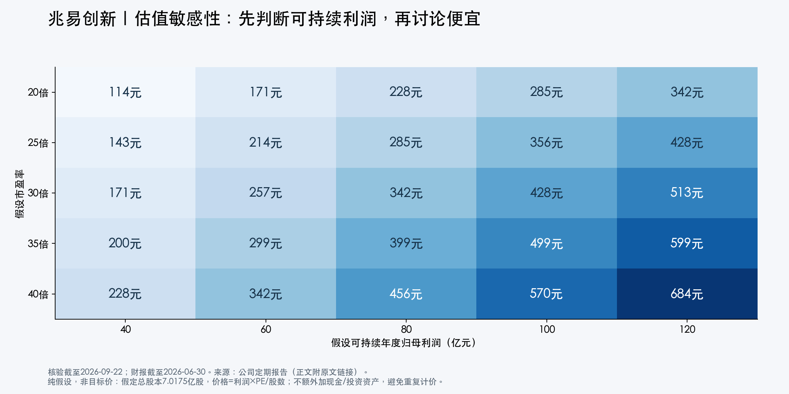

# 兆易创新：估值口径与情景分析

研究日2026-09-22；财报截至2026H1。行情使用本次可核验页面报价391.71元作为参考锚，沿用2026-09-21收盘口径，不将其表述为9月22日实时成交价。[行情来源](https://cn.investing.com/equities/gigadevice-semiconductor-beijing)

## 判断

**公司业绩仍在加速，股价是否便宜取决于高利润的持续时间。** 用过往低谷利润估值会高估“贵”的程度，用最新一个高峰季度年化则会低估风险。更有价值的问题是：未来几年公司能否稳定实现80—100亿元左右的年度扣非归母利润，以及市场愿意给多少倍估值。

## 一、先统一分子与分母

行情页约7.0175亿股为参考股数，391.71元×7.0175亿股≈2748.8亿元。以下采用四舍五入后的2750亿元作为**按A股价格折算全部股份的等价股权价值**。它不是“A股股份市值+H股股份市值”的严格合计，也不是精确流通市值。A/H价格不同、期权行权、回购及时点变化会影响实际数值。

| 利润口径 | 归母利润（亿元） | 2750亿元÷利润 | 含义与限制 |
|---|---:|---:|---|
| 2025实际归母 | 16.48 | 166.9倍 | 反映过去全年，无法代表已实现的2026加速 |
| 截至2026Q2归母TTM | 79.29 | 34.7倍 | 真实滚动四季，但含投资公允价值收益 |
| 截至2026Q2扣非TTM | 58.08 | 47.3倍 | 更接近主营表现，但仍非中周期利润 |
| 2026H1扣非×2 | 97.66 | 28.2倍 | 仅年化运转率，不是TTM或全年预测 |
| 2026Q2扣非×4 | 138.92 | 19.8倍 | 对Q2可重复性的假设很强，不作基准预测 |

TTM公式：2025全年+2026H1−2025H1。利润来自[2025年报](https://static.cninfo.com.cn/finalpage/2026-03-31/1225061352.PDF)和[2026半年报](https://static.cninfo.com.cn/finalpage/2026-08-19/1225480384.PDF)。这些比率不是行情供应商的标准EPS口径PE，不能混称；H股发行也使加权EPS与期末股本计算的EPS存在差异。

上一版的20倍和28倍均为年化口径；本版明确补充真实TTM，避免把“年化便宜”当成已经兑现的安全边际。

## 二、把长期利润假设落到业务数字

下面是假设一个未来完整年度的中周期状态，用于压力测试，**不代表2026全年或2027年预测，也不赋予发生概率**。因为2026H1扣非已实现48.83亿元，低于该值的年度情景只能用来描述以后年度的回落状态。

简化模型：经营归母利润≈（收入×毛利率−经营费用及其他净负担）×（1−12%有效税率）。其他净负担包括销售、管理、研发费用、税金附加、财务费用及经常性减值等的净额；假定非经常性收益为零、少数股东影响忽略，存在估算误差。12%税率是情景假设，不是法定税率。

| 情景 | 收入 | 毛利率 | 费用及其他净负担 | 测算利润 | 假设PE | 隐含每股价格 |
|---|---:|---:|---:|---:|---:|---:|
| 周期回落 | 180亿元 | 45% | 35亿元 | 40.48亿元 | 20—25倍 | 约115—144元 |
| 高景气部分保留 | 240亿元 | 55% | 40亿元 | 80.96亿元 | 25—35倍 | 约288—404元 |
| 高景气持续 | 290亿元 | 60% | 44亿元 | 114.40亿元 | 30—35倍 | 约489—571元 |

PE区间是研究者的敏感性假设，没有以未核验的同业均值背书。模型旨在说明收入、毛利率和估值双重变化会产生多大差异；其中高景气情景收入约等于Q2年化水平，已隐含较强出货与需求持续性。

图中原始假设及结果（元/股，股数固定为7.0175亿股）：

| PE\年度利润 | 40亿元 | 60亿元 | 80亿元 | 100亿元 | 120亿元 |
|---|---:|---:|---:|---:|---:|
| 20倍 | 114 | 171 | 228 | 285 | 342 |
| 25倍 | 143 | 214 | 285 | 356 | 428 |
| 30倍 | 171 | 257 | 342 | 428 | 513 |
| 35倍 | 200 | 299 | 399 | 499 | 599 |
| 40倍 | 228 | 342 | 456 | 570 | 684 |

反推391.71元：若给30倍PE，需要可持续年利润约91.63亿元；若给35倍，需要约78.54亿元；若只能给25倍，需要约109.95亿元。这才是当前买入需要接受的主要盈利假设。以上用2750亿元近似分子反推。

## 三、不要重复给现金和投资资产估值

以上直接使用归母利润×PE，**没有再加现金和长鑫等股权资产**。若做分部估值，应先从利润中剔除相应现金利息、投资收益、公允价值收益并调整税收，再加回可分配的超额净现金和税后可实现投资价值。

还应扣除业务所需营运现金、受限资金、债务、相关税负或流动性折价。H1货币资金169.65亿元与现金及现金等价物139.29亿元不是同一概念；不能全部视为随时可分配现金。长鑫股权期末100.62亿元为账面公允价值，既不是已经收到的现金，也未进入本期净利润。[半年报第14、24页](https://static.cninfo.com.cn/finalpage/2026-08-19/1225480384.PDF)

## 四、股价真正博弈的四件事

| 分歧 | 上行验证 | 下行验证 |
|---|---|---|
| 供给缺口持续多久 | 行业供给仍紧，订单实际转收入 | 交期缩短、报价下行、需求递延 |
| 高毛利能维持多久 | 毛利率趋稳，销量补充增长 | 售价放缓而采购成本上升，毛利连续下降 |
| 是否形成第二增长来源 | MCU、定制化存储利润贡献可量化 | 仅项目进展，收入与现金迟迟未体现 |
| 市场给多少PE | 高扣非增长和现金回款连续兑现 | 业绩增速放缓，利润与倍数同时下修 |

公司半年报说明会对景气持续较乐观，但也预期成本上升后毛利率逐渐趋稳；这说明“价格继续涨”不等于“毛利率继续大幅升”。[管理层答复](https://roadshow.cnstock.com/fbh/zycx202606)

资金、情绪和技术位置：本次未核验实时持仓、资金流和统一复权的日K序列，因此不声称主力正在吸筹，也不将历史高点到当前的价差直接解释为便宜。回购、股东变动可以影响短期供求，但不能替代持续盈利。

## 五、当前应怎样看

对企业经营偏积极，对价格是否有安全边际保持条件判断。若接受“可持续扣非利润约100亿元、30倍估值”，391.71元附近有讨论空间，但与模型约428元相比余量有限；若中周期利润只能维持60亿元，同样30倍对应约257元，风险明显。

因此，不能仅靠“国产替代”“AI存储”或“28倍年化PE”给出确定买入结论。下一次财报应重点验证Q2扣非利润的可重复性、毛利率趋稳后的销量增长，以及营运资金效率。该分析未结合个人持仓、成本和资金期限，不给出个人仓位比例。
