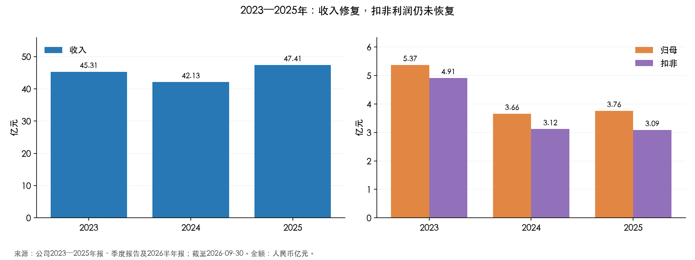
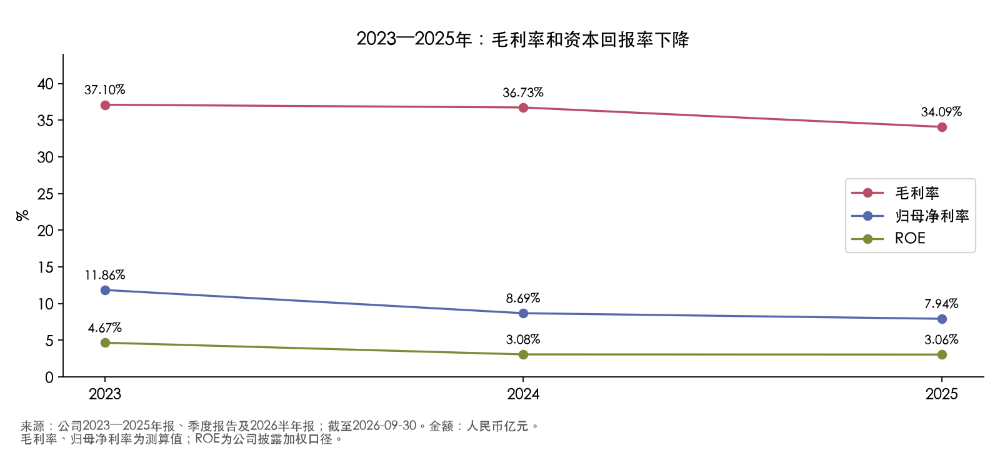
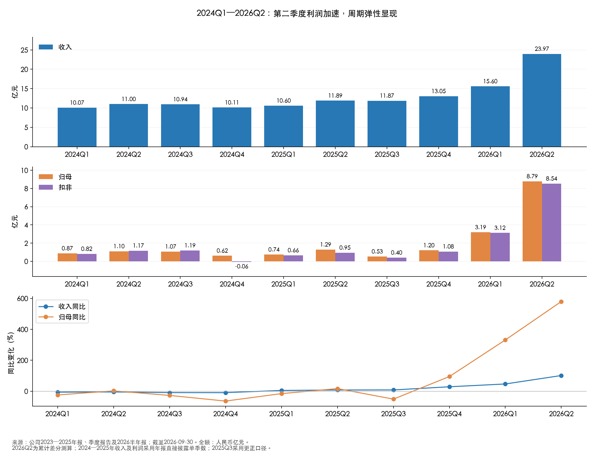
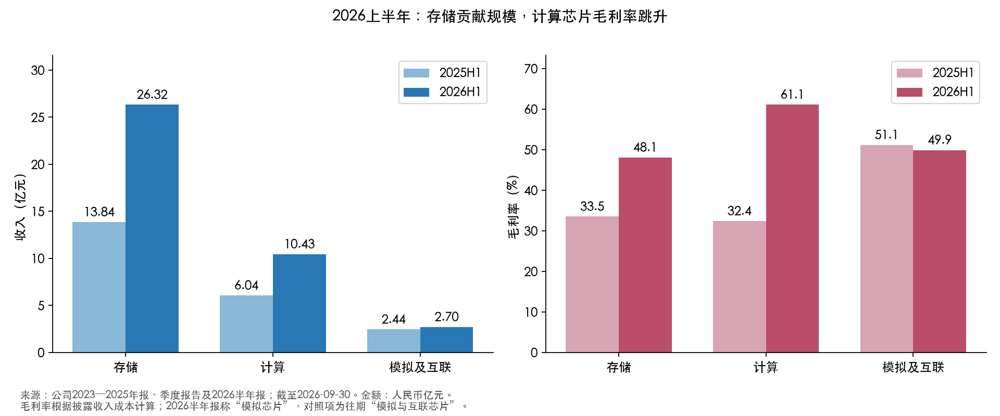
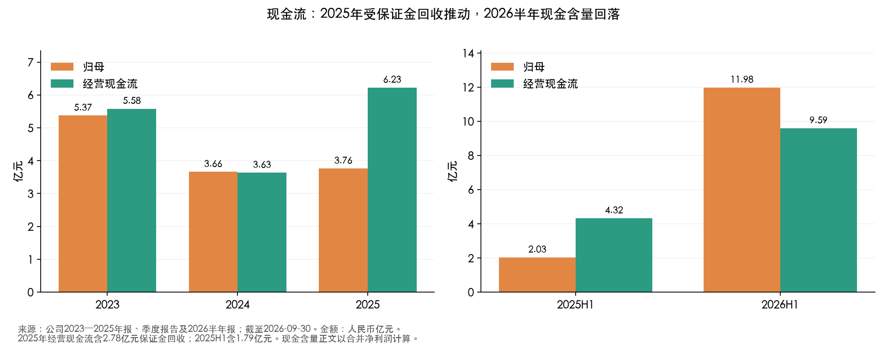
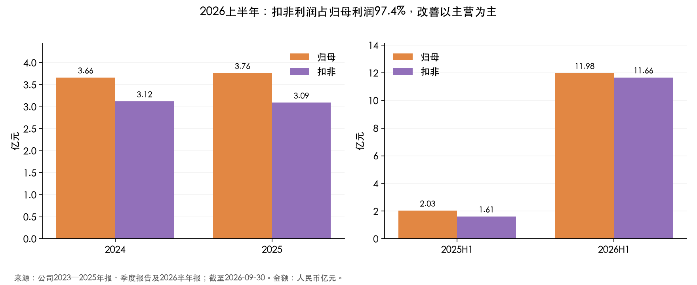

# 君正股份（300223，原北京君正）财务分析

研究日期：2026-09-30。年度覆盖2023—2025年；季度覆盖2024Q1—2026Q2，共10个单季度；最新正式财报为2026年半年报。2026年三季报尚不在本次已披露数据范围内。证券简称于2026-08-13变更为“君正股份”，公司全称及代码不变。

## 核心结论

**2023—2025年是盈利下行后弱修复，2026年上半年则出现明显的主营利润跃升。此次改善与存储和计算芯片涨价密切相关，不能直接把二季度的利润率当作长期水平。**

- 趋势事实：2025年收入47.41亿元、同比增长12.54%，但扣非利润3.09亿元、同比下降0.93%；毛利率继续下降至34.09%。2026H1收入39.57亿元、归母11.98亿元、扣非11.66亿元，同比增幅分别75.95%、489.59%、624.75%。
- 原因判断：2026H1存储和计算芯片同时受益于提价及供需紧张，计算芯片毛利率达到61.06%；研发、销售和管理费用的增速低于收入，放大了利润弹性。公司披露涨价及需求因素，但未提供足以定量拆分收入增长的销量和平均售价数据，不能把全部增长都归为销量扩张。
- 主要保留：2025年经营现金流增长含保证金回收；2026H1应收账款加速增长、经营现金流低于净利润；商誉及库存金额较大。财务安全性较强，利润率可持续性仍取决于后续价格和成本。

## 1. 统计口径与数据修订

金额除注明外为人民币亿元，合并口径；净利率特指归母净利润/收入。现金含量采用经营现金流/合并净利润，避免混淆少数股东口径。半年ROE为半年加权指标，未年化；半年收入不能与全年直接比较增速。资本开支仅取购建固定资产、无形资产及其他长期资产支付现金；简化自由现金流=经营现金流−上述资本开支，不是完整估值用自由现金流。

2024—2025年单季收入、归母、扣非及现金流优先采用年报分季度直接披露值；2026Q2以上半年减Q1还原，标记为**测算值**。所有Q2/Q3/Q4营业成本采用同口径累计差分，毛利率据单季收入成本测算，不相减累计毛利率。2023单季作为同比/环比基期保存在底表。

2025三季报于2025-11-24更正，将1,143.78万元H股发行中介费用从管理费用调整，并修订现金流分类。本文采用更正后Q3归母5,262.72万元、扣非4,039.18万元；旧版本不可混用。2024Q4扣非为-602.12万元，已与年报原文核对；后续以该负数为基数时写“扭亏”，不计算失真的增长率。

## 2. 三年年度与最新半年底表

| 指标（亿元，比例除外） | 2023 | 2024 | 2025 | 2025H1 | 2026H1 |
| --- | --- | --- | --- | --- | --- |
| 收入 | 45.31 | 42.13 | 47.41 | 22.49 | 39.57 |
| 成本 | 28.50 | 26.65 | 31.25 | 14.50 | 19.09 |
| 归母 | 5.37 | 3.66 | 3.76 | 2.03 | 11.98 |
| 扣非 | 4.91 | 3.12 | 3.09 | 1.61 | 11.66 |
| 毛利率 | 37.10% | 36.73% | 34.09% | 35.54% | 51.75% |
| 归母净利率 | 11.86% | 8.69% | 7.94% | 9.03% | 30.26% |
| 经营现金流 | 5.58 | 3.63 | 6.23 | 4.32 | 9.59 |
| 现金含量 | 108.23% | 99.80% | 165.88% | 214.34% | 79.92% |
| 研发投入 | 7.18 | 6.93 | 7.20 | 3.53 | 3.89 |
| 研发费用 | 7.08 | 6.81 | 7.12 | 3.48 | 3.82 |
| 研发资本化 | 0.09 | 0.12 | 0.08 | 0.04 | 0.07 |
| ROE | 4.67% | 3.08% | 3.06% | 1.67% | 9.18% |
| 资产 | 127.42 | 129.27 | 135.73 | 134.12 | 150.25 |
| 负债 | 9.13 | 8.44 | 10.84 | 9.60 | 13.79 |
| 资产负债率 | 7.16% | 6.53% | 7.99% | 7.16% | 9.18% |
| 存货 | 24.05 | 26.72 | 29.75 | 27.73 | 31.45 |
| 应收 | 4.03 | 3.89 | 4.67 | 4.49 | 9.34 |
| 货币资金 | 39.27 | 37.17 | 40.92 | 37.90 | 39.58 |
| 交易性金融资产 | 3.94 | 7.58 | 9.00 | 12.59 | 14.63 |
| 销售费用 | 3.13 | 2.95 | 3.20 | 1.63 | 2.08 |
| 管理费用 | 1.79 | 2.15 | 2.68 | 1.26 | 1.15 |
| 财务费用 | -0.93 | -0.75 | -1.04 | -0.70 | -0.29 |
| 资本开支 | 1.04 | 1.13 | 0.97 | 0.43 | 0.84 |
| 简化自由现金流 | 4.54 | 2.50 | 5.26 | 3.89 | 8.75 |

原始披露数及每项PDF页码见[逐项来源索引](原始数据/逐项来源索引.json)；比例、资本化差额及简化自由现金流为测算值。研发资本化=总投入−研发费用；研发费用并不等于总投入。已资本化研发项目的当期摊销未单独拆出，不将集团无形资产摊销全部视作研发摊销。

2024年收入同比下降7.03%，归母下降31.84%，扣非下降36.52%，利润下滑明显快于收入。2025年收入超过2023年，但归母仍较2023年低29.97%，扣非低37.11%。因此，2025年的收入回升没有同步转化为核心盈利修复。

2023—2025年毛利率由37.10%降至34.09%，归母净利率由11.86%降至7.94%，ROE由4.67%降至3.06%。2025年毛利额只增加约0.69亿元，而销售、管理、研发费用合计增加约1.09亿元，抵消了收入增长效应；资产处置、财务净收益和税费变化等共同支撑了归母利润微增。2025年研发总投入7.20亿元，同比增长3.83%，资本化比例只有1.11%，并非靠大规模研发资本化抬升利润。

## 3. 单季度：拐点在2026年，二季度进一步加速

| 期间 | 收入 | 归母 | 扣非 | 营业成本 | 毛利率 | 经营现金流 |
| --- | --- | --- | --- | --- | --- | --- |
| 2024Q1 | 10.07 | 0.87 | 0.82 | 6.30 | 37.45% | -0.61 |
| 2024Q2 | 11.00 | 1.10 | 1.17 | 6.85 | 37.68% | 1.50 |
| 2024Q3 | 10.94 | 1.07 | 1.19 | 6.87 | 37.20% | 1.17 |
| 2024Q4 | 10.11 | 0.62 | -0.06 | 6.63 | 34.47% | 1.57 |
| 2025Q1 | 10.60 | 0.74 | 0.66 | 6.74 | 36.40% | 1.75 |
| 2025Q2 | 11.89 | 1.29 | 0.95 | 7.76 | 34.76% | 2.57 |
| 2025Q3 | 11.87 | 0.53 | 0.40 | 8.12 | 31.63% | 0.78 |
| 2025Q4 | 13.05 | 1.20 | 1.08 | 8.63 | 33.82% | 1.12 |
| 2026Q1 | 15.60 | 3.19 | 3.12 | 8.81 | 43.49% | 2.17 |
| 2026Q2 | 23.97 | 8.79 | 8.54 | 10.28 | 57.12% | 7.42 |

**测算标记：**2026Q2金额全部为H1−Q1；各年Q2/Q3/Q4营业成本为累计差分；全部季度毛利率为测算值。其余列为公司直接披露单季数。

| 期间 | 收入同比 | 收入环比 | 归母同比 | 归母环比 | 扣非同比 | 扣非环比 |
| --- | --- | --- | --- | --- | --- | --- |
| 2024Q1 | -5.8% | -9.4% | -23.9% | -48.3% | -26.0% | -43.6% |
| 2024Q2 | -4.5% | +9.2% | +2.6% | +26.3% | +22.6% | +43.2% |
| 2024Q3 | -8.7% | -0.5% | -26.9% | -3.0% | -15.2% | +1.8% |
| 2024Q4 | -9.0% | -7.6% | -63.4% | -42.2% | -104.2% | -105.1% |
| 2025Q1 | +5.3% | +4.8% | -15.3% | +19.6% | -18.8% | 扭亏 |
| 2025Q2 | +8.1% | +12.1% | +17.2% | +74.8% | -19.2% | +42.5% |
| 2025Q3 | +8.5% | -0.1% | -50.8% | -59.3% | -66.1% | -57.3% |
| 2025Q4 | +29.0% | +9.9% | +95.0% | +128.9% | 扭亏 | +166.8% |
| 2026Q1 | +47.1% | +19.6% | +331.6% | +164.8% | +370.6% | +189.8% |
| 2026Q2 | +101.7% | +53.7% | +580.0% | +175.4% | +803.1% | +173.5% |

- 2024Q1—Q4：收入在约10—11亿元窄幅波动，全年需求修复不足。Q4归母降至0.62亿元，扣非小幅亏损，是年度低点。Q2/Q3扣非高于归母、Q4则显著低于归母，表明非经常损益的单季分布明显不均；年报未提供足够逐季度项目明细，不能把这一波动全归于主营恶化或单一补助。
- 2025Q1—Q2：收入缓慢恢复，但成本及费用使利润未稳定增长；Q2归母环比修复，扣非仍同比下降。2025H1有约0.24亿元资产处置收益，归母和扣非的增速应分开看。
- 2025Q3：收入与Q2基本持平，而单季毛利率降至31.63%、归母降至0.53亿元；说明当时收入复苏尚未覆盖成本及费用压力。此处已采用更正后利润。
- 2025Q4：收入13.05亿元，环比增长9.86%；归母1.20亿元，扣非1.08亿元。扣非相对上年同期扭亏，属于改善，但有负基数效应。
- 2026Q1：收入15.60亿元、毛利率43.49%，扣非3.12亿元，盈利拐点开始清晰。存储客户陆续进入长协调价周期，计算芯片也面临供需紧张及提价。
- 2026Q2：测算收入23.97亿元、归母8.79亿元、扣非8.54亿元；收入同比增长101.66%，归母同比增长579.96%，扣非同比增长803.08%。毛利率57.12%，比Q1提高13.63个百分点。利润增速远高于收入，核心是毛利率和费用摊薄，而非单纯销售额增加。

## 4. 产品结构：存储是主体，计算芯片利润弹性更大

| 期间 | 产品 | 收入 | 成本 | 收入占比 | 毛利率 | 毛利额 |
| --- | --- | --- | --- | --- | --- | --- |
| 2024 | 存储芯片 | 25.89 | 16.95 | 61.47% | 34.55% | 8.95 |
| 2024 | 计算芯片 | 10.90 | 7.30 | 25.88% | 33.02% | 3.60 |
| 2024 | 模拟及互联芯片 | 4.72 | 2.38 | 11.19% | 49.61% | 2.34 |
| 2025 | 存储芯片 | 29.11 | 19.81 | 61.41% | 31.95% | 9.30 |
| 2025 | 计算芯片 | 12.93 | 8.94 | 27.28% | 30.86% | 3.99 |
| 2025 | 模拟及互联芯片 | 5.06 | 2.47 | 10.67% | 51.09% | 2.58 |
| 2025H1 | 存储芯片 | 13.84 | 9.21 | 61.56% | 33.48% | 4.64 |
| 2025H1 | 计算芯片 | 6.04 | 4.09 | 26.87% | 32.37% | 1.96 |
| 2025H1 | 模拟及互联芯片 | 2.44 | 1.19 | 10.84% | 51.14% | 1.25 |
| 2026H1 | 存储芯片 | 26.32 | 13.67 | 66.50% | 48.07% | 12.65 |
| 2026H1 | 计算芯片 | 10.43 | 4.06 | 26.37% | 61.06% | 6.37 |
| 2026H1 | 模拟及互联芯片 | 2.70 | 1.35 | 6.81% | 49.86% | 1.34 |

毛利额与占比为测算；上述三条产品线未包含技术服务、租赁及少量其他收入。2026半年报用“模拟芯片”标题，历史报告称“模拟与互联芯片”，这里按半年报列示的可比上年数据对照，未自行重分历史业务。毛利贡献不能当作业务净利润贡献，销售、研发和管理等费用尚未分摊。

2025年存储收入增长12.43%、计算增长18.65%，但两者毛利率分别下降2.60、2.16个百分点，解释了“增收不增扣非利润”。模拟与互联业务毛利率改善，但规模较小，难以逆转集团趋势。

2026H1存储收入26.32亿元，占总收入66.50%，毛利率48.07%；计算收入10.43亿元，占26.37%，毛利率61.06%。两条业务分别贡献约12.65亿元和6.37亿元毛利，同比新增约8.02亿元、4.42亿元，两者合计解释集团约12.49亿元毛利增量的绝大部分。模拟业务收入增长10.59%，毛利率49.86%，同比略降。

公司解释，汽车和工业客户的DRAM长协在2025下半年仍基本执行原售价，2026Q1起陆续调价；存储产业供需变化、客户需求与新产品共同推动增长。计算芯片因存储原材料紧缺而供应紧张、产品普遍提价。**分析判断：**计算芯片当前高毛利率包含供需与价格因素；没有证据证明其已永久提升到60%以上。后续原材料成本传导和消费端需求承受能力同样重要。

地区上，2025年境外主营收入39.19亿元、占总收入82.67%，同比增长12.41%；境内主营收入8.13亿元、增长13.18%，另有境内租赁收入0.09亿元。境外业务占比高，应关注汇率对折算收入和财务费用的影响，但现有数据不足以拆出恒定汇率增速。

## 5. 盈利质量：现金流改善须拆开看

**2025年的现金流增长包含一次性资金释放。**经营现金流6.23亿元，同比增长71.30%，其中保证金回收2.78亿元。作单因素敏感性调整后，经营现金流约3.44亿元，较2024年的3.63亿元下降约5.3%；这不是公司披露的调整后指标，也不代表排除了所有一次性因素。保证金回收占当年经营现金流44.7%，不宜将6.23亿元全部视作可持续主营现金创造能力。来源：2025年报第178—179页现金流附注。

**2026H1现金流绝对额改善，但回款速度需观察。**经营现金流9.59亿元、同比增长121.73%，对合并净利润覆盖率79.92%，较2025H1的214.34%回落。上年同期含1.79亿元保证金回收，因此单看覆盖率下降会夸大恶化程度；同时，公司本期利润大增而营运资金占用上升，也是真实约束。

现金流调节表显示，2026H1经营性应收项目增加占用现金4.33亿元，存货增加占用1.44亿元，经营性应付项目增加提供2.21亿元。期末应收9.34亿元，同比增长108.05%，高于同期收入75.95%的增幅；较2025年末翻倍。由于二季度收入加速，期末应收自然会增加，不能仅凭增幅认定回款异常。采用期初期末平均应收/半年收入×181天，2025H1与2026H1简化应收周转天数约33.7天、32.0天，尚未显示整体周转恶化，仍须检验三季度实际回款及账龄。

存货2024、2025年分别增长11.11%、11.33%，2024年快于收入增长且毛利率下降，提示低景气期的库存压力。2026H1存货31.45亿元，较2025年末增长5.72%、同比增长13.39%；低于收入增幅，但同期营业成本同比增长31.69%，因此观察库存周转应以成本作分母。期初期末平均存货/半年成本×181天估计由约339.9天下降至290.0天，趋势改善但绝对库存仍大，且该简化算法受季节性影响。2026H1资产减值损失0.62亿元，高于上年同期0.42亿元，不能因收入增长忽略跌价与研发项目减值。

2025年非经常损益0.67亿元，占归母17.85%；主要项目包括资产处置0.24亿元、政府补助0.17亿元、金融资产相关损益0.36亿元，再扣税费等。2026H1非经常损益降至0.31亿元，只占归母2.62%，扣非利润占97.38%，支持本轮增长主要来自经营业务的判断。理财收益、财务净收益与非经常损益不能简单相加，前者可能已包含在后者中。

2025年销售、管理、研发费用率合计27.42%；可比半年口径由2025H1的28.37%降至2026H1的17.82%；同期三项费用合计绝对额仍增长，并非大幅削减研发换取利润。毛利率提升、收入规模扩大同时摊薄费用，是2026H1利润率跳升的主要解释。

## 6. 资产安全与资本回报

2026年6月末资产负债率9.18%，货币资金39.58亿元，交易性金融资产14.63亿元。低杠杆和较多金融资产提供了缓冲，但交易性金融资产不等同现金，也不推定所有货币资金都可自由动用。2025年现金及现金等价物40.87亿元，低于货币资金40.92亿元，差额对应受限资金等口径差异。

商誉连续维持30.08亿元，约占2026H1总资产20.02%、归母权益22.11%，是长期资产可回收性检查重点；这只是风险敞口，并不等于已经发生商誉减值。2023—2025年低ROE也显示资产体量较大、盈利兑现偏弱；2026H1的9.18%加权ROE显著改善，但不得简单乘二当作全年预测。半年资产负债表不包含6月后H股发行等后续事项的资金变化。

## 7. 亮点、风险与下一期验证

| 类型 | 已核验事实 | 分析判断与可持续性 | 下一期验证 |
| --- | --- | --- | --- |
| 主营盈利亮点 | 2026H1扣非11.66亿元，同比增长624.75%，占归母97.38% | 增长并非主要依赖补助或处置；但供需涨价贡献需持续检验 | Q3单季扣非、存储与计算毛利率 |
| 研发与财务安全亮点 | 2025研发投入7.20亿元、资本化1.11%；2026H1负债率9.18% | 研发投入延续，短期偿债压力相对较低；资金多并不保证回报率 | 研发新品收入、现金用途、ROE |
| 价格持续性风险 | 2026Q2测算毛利率57.12%，计算H1毛利率61.06% | 高利润弹性可能在成本补涨或价格回落时反向作用 | 合同调价、原料成本、产品需求、毛利率环比 |
| 回款与存货风险 | 应收同比+108.05%，存货31.45亿元；H1现金含量79.92% | 平均应收周转未恶化，暂不能定性回款出问题；需要账龄与收款验证 | 销售收现、应收账龄、逾期款、存货跌价 |
| 现金流可比性风险 | 2025全年保证金回收2.78亿元，H1回收1.79亿元 | 历史高现金流不能全部外推 | 剔除保证金影响后的现金流与利润匹配 |
| 商誉风险 | 商誉30.08亿元 | 需依赖被收购业务未来现金流支持价值 | 商誉减值测试及关键假设变化 |

**未来假设而非预测：**若存储长协调价延续、计算芯片价格覆盖原料成本且回款正常，高毛利和费用摊薄可继续支持利润；若供需缓和、售价先跌而成本后降，季度利润可能比收入更快回落。不能仅按2026Q2利润乘四进行估值。

## 8. 原始资料与复算

全部PDF、提取文本、原始输入、测算结果与图表保存在本股票目录。下载与研究日期2026-09-30，详情见[来源清单](原始资料/来源清单.md)。[披露数据](原始数据/披露数据.json)、[测算数据](原始数据/测算数据.json)、[生成脚本](原始数据/生成分析.py)、[核验记录](原始数据/核验记录.txt)可复核；图表使用同一底表生成。

核验包括2023—2025年四季合计等于全年、2026Q1+Q2等于H1、资产=负债+权益，允许浮点误差小于0.03元。2024Q4负扣非及2025Q3更正已特别标注。金额表显示到0.01亿元，可能出现显示精度的尾差；原始底表保留人民币元。
