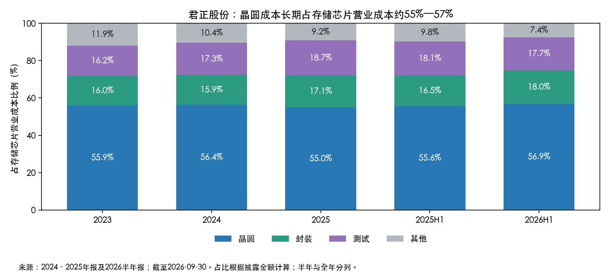

# 君正股份存储芯片：晶圆成本占比分析

研究日期：2026-09-30。对象为君正股份（300223，原北京君正）存储芯片业务，不代表整个存储行业或某一类DRAM、SRAM、Flash的成本结构。

**结论：财报披露的“晶圆”成本约占存储芯片营业成本的55%—57%，2026上半年为56.87%。这是最接近晶圆代工成本的公开口径，但不能严格等同于单独的代工加工费。**

公司采用Fabless模式，将晶圆制造及封装测试委外。财报将营业成本拆成“晶圆、封装、测试、其他”，没有继续拆分晶圆项中的裸硅片、其他材料与纯加工服务收费，也未披露按代工厂或按存储品种的成本。因此，不宜将56.87%表述成已核验的“纯代工费占比”。这是已售产品结转的营业成本，不是本期现金采购或给晶圆厂的付款比例；也不包含研发、销售和管理等期间费用。

| 期间 | 晶圆成本（亿元） | 存储营业成本（亿元） | 晶圆占比 | 封装占比 | 测试占比 | 其他占比 |
| --- | --- | --- | --- | --- | --- | --- |
| 2023 | 10.35 | 18.49 | 55.94% | 15.96% | 16.18% | 11.91% |
| 2024 | 9.56 | 16.95 | 56.39% | 15.89% | 17.34% | 10.38% |
| 2025 | 10.90 | 19.81 | 55.00% | 17.11% | 18.70% | 9.20% |
| 2025H1 | 5.12 | 9.21 | 55.63% | 16.51% | 18.07% | 9.80% |
| 2026H1 | 7.77 | 13.67 | 56.87% | 17.98% | 17.72% | 7.43% |

来源：2023、2024数字可在2024年报“营业成本构成”产品分类表核对；2025年报第25页；2026半年报第21页。总成本为四项相加，占比为测算，和披露百分数一致。半年金额不可与全年直接比较增长率。

## 对盈利的含义

1. **晶圆是最大成本，但封测也很重要。**2026H1每100元存储营业成本中，晶圆56.87元、封装17.98元、测试17.72元、其他7.43元。封测合计35.70%，因此只盯晶圆价格会遗漏约三分之一的成本。
2. **晶圆占比总体稳定，半年有所抬升。**2023—2025年占比55.94%、56.39%、55.00%，2026H1升至56.87%，较上年同期提高1.24个百分点。占比变化也受产品组合、出货量、良率、库存成本结转和封测成本变化影响，不能据此倒推出晶圆代工单价涨幅。
3. **2026H1存储毛利率改善，并非晶圆成本总额下降。**晶圆成本由5.12亿元增至7.77亿元，同比增长约51.74%；存储总营业成本增长48.41%，收入增长90.08%，毛利率从33.48%升至48.07%。收入增速超过成本是直接数学原因；公司将经营改善与调价及需求增长等联系起来，现有数据不足以拆出量价各自贡献。

## 晶圆涨价敏感性：机械测算，不是业绩预测

以2026H1为基准，假设同样销量、产品组合和售价，只有已结转的晶圆成本上升10%，其余成本不变：

- 晶圆成本增加约0.777亿元；
- 存储总营业成本上升约5.69%；
- 存储毛利率下降约2.95个百分点，从48.07%降至约45.11%；
- 若通过产品提价维持原毛利额，平均售价需提高约2.95%；若要维持原毛利率，则需提高约5.69%。

公式：营业成本增幅=晶圆成本占比×10%；毛利率下降百分点=晶圆成本/营业收入×10%×100。前述两种提价对应“保持利润金额”和“保持利润率”，目标不同。

实际影响还取决于采购合同、库存消化节奏及售价传导，晶圆厂报价上涨通常不会全部在当期营业成本中体现；财报也未提供足够季度分项成本，不能可靠拆到单季度。上述敏感性针对存储业务毛利，不是集团净利润，未考虑税费、期间费用或价格变化对需求的反馈。

## 来源与原始数据

- [2024年年度报告](https://disc.static.szse.cn/disc/disk03/finalpage/2025-04-18/66fcd6df-4142-46f1-b61a-7b08f965459c.PDF)，产品分类成本构成。
- [2025年年度报告](https://disc.static.szse.cn/disc/disk03/finalpage/2026-03-28/c69aa770-90f4-4477-8f29-028f60e1ae93.PDF)，第25页。
- [2026年半年度报告](https://disc.static.szse.cn/disc/disk03/finalpage/2026-08-29/e014eec0-17cd-4ead-b70b-c18248367e7a.PDF)，第21页成本结构，第35页供应链风险。
- 原始PDF及文本在本目录“原始资料”；[结构化底表](原始数据/存储芯片成本构成.json)、[复算与制图脚本](原始数据/存储晶圆成本分析.py)。
