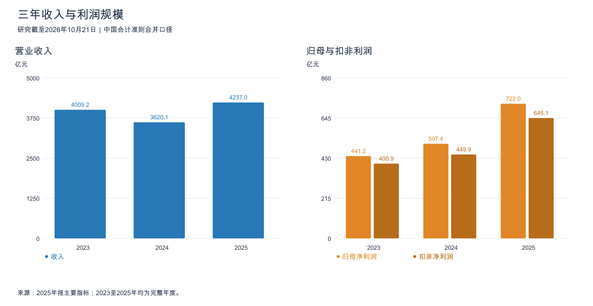
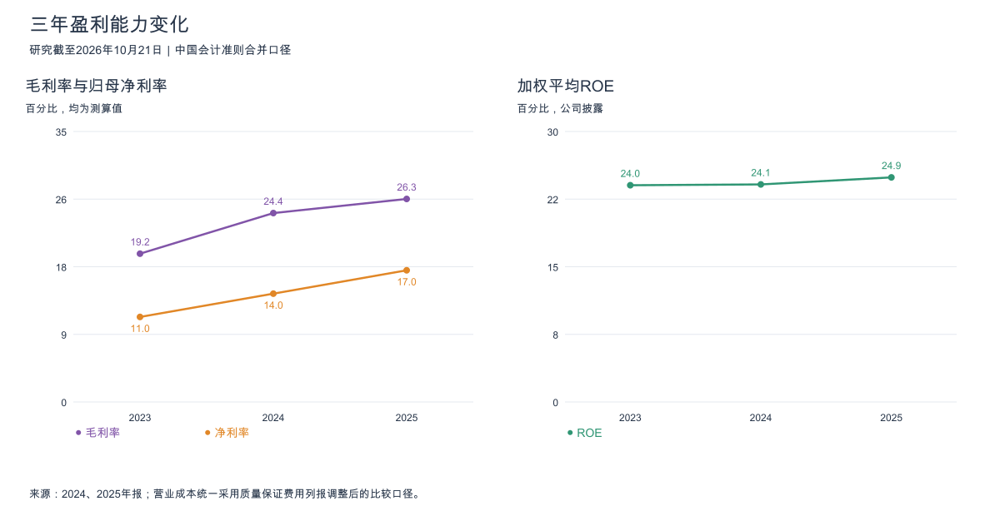
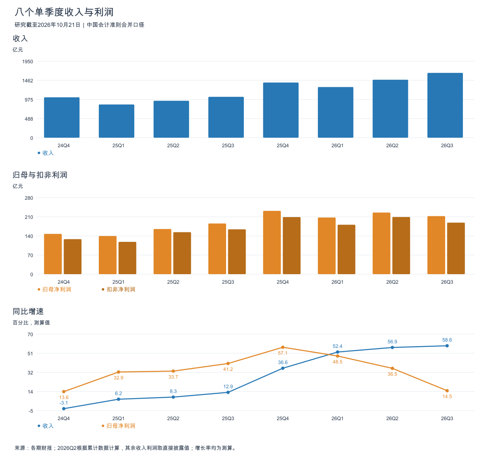
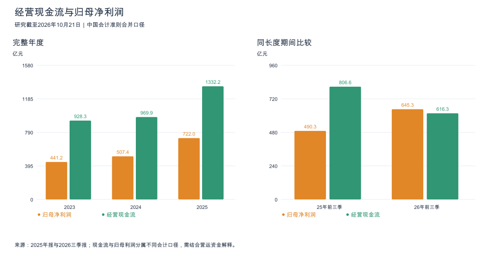
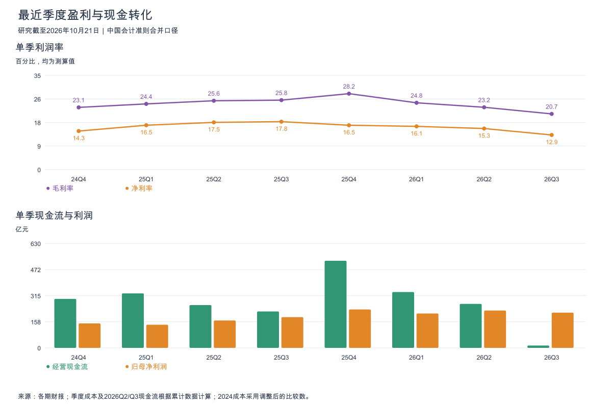
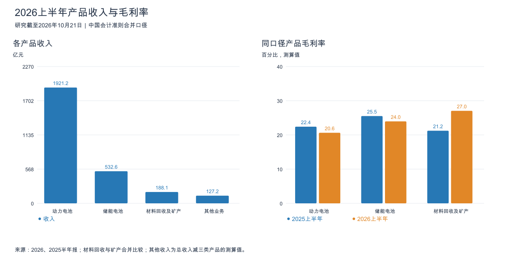

# 宁德时代三年与八季度财务分析

研究截至2026年10月21日；证券代码300750.SZ、03750.HK。年度覆盖2023至2025年，最新数据为2026年三季报，八个单季度覆盖2024Q4至2026Q3。采用中国会计准则合并报表，金额为人民币亿元；比率、增速及差分均为测算值。

## 财务结论

宁德时代仍有较强盈利能力和现金储备，但2026年的增长质量弱于2025年：收入加速，利润增速放缓，最近三个季度毛利率连续下降；Q3现金转化尤其弱，需要将关注点从收入规模转向单位盈利及营运资金。

2026年前三季度收入4,421.37亿元，同比增长56.19%；归母645.30亿元、扣非578.76亿元，分别增长31.60%、32.68%。Q3单季收入1,652.21亿元，同比增长58.58%，归母增长14.54%，扣非增长14.86%。收入、核心利润仍在增长，这是经营韧性；利润明显跑输收入，则表明规模扩张未能维持此前利润率。[2026三季报，第1页](https://static.cninfo.com.cn/finalpage/2026-10-21/1225613175.PDF)

最需要验证的两项是：Q4毛利率能否止跌，以及Q3被应收、备货和供应商付款占用的资金能否回收。单季现金流弱不能直接推出坏账或造假，但不足以继续沿用“现金流始终显著高于利润”的旧判断。

## 统计口径与历史成本调整

2024年执行企业会计准则解释第18号后，保证类质量保证费用从销售费用调整到营业成本。2024年影响金额118.43亿元；2023年比较成本相应增加149.12亿元，销售费用等额减少。该变化影响毛利率与销售费用率，不直接改变净利润。[2024年报，第162至163页](https://static.cninfo.com.cn/finalpage/2025-03-15/1222806982.PDF)

因此，本报告2023、2024年成本采用后续财报调整后的比较数。2024Q4成本以调整后全年成本减2025三季报中的2024年前三季度比较成本计算，没有直接拼接原2024三季报成本。2023年毛利率19.19%为统一列报后的测算值，与原年报旧口径的毛利率不可混用。

## 三年年度趋势

| 指标 | 2023年 | 2024年 | 2025年 | 2026前三季度 |
|---|---:|---:|---:|---:|
| 营业收入 | 4,009.17 | 3,620.13 | 4,237.02 | 4,421.37 |
| 营业成本 | 3,239.82 | 2,735.19 | 3,123.83 | 3,416.95 |
| 归母净利润 | 441.21 | 507.45 | 722.01 | 645.30 |
| 扣非归母净利润 | 400.92 | 449.93 | 645.08 | 578.76 |
| 毛利率 | 19.19% | 24.44% | 26.27% | 22.72% |
| 归母净利率 | 11.01% | 14.02% | 17.04% | 14.60% |
| 经营现金流净额 | 928.26 | 969.90 | 1,332.20 | 616.25 |
| 研发投入* | 183.56 | 186.07 | 221.47 | 185.17* |
| 加权平均ROE | 24.04% | 24.13% | 24.91% | 17.64% 未年化 |
| 资产负债率 | 69.34% | 65.24% | 61.94% | 64.23% |
| 期末存货 | 454.34 | 598.36 | 945.26 | 1,447.70 |
| 期末应收账款净额 | 640.21 | 641.36 | 764.03 | 1,129.12 |
| 期末货币资金 | 2,643.07 | 3,035.12 | 3,335.13 | 3,698.14 |

年度指标来源：[2025年报，第11至12、30页及合并报表](https://static.cninfo.com.cn/finalpage/2026-03-10/1225002214.PDF)、[2024年报合并报表及成本调整说明](https://static.cninfo.com.cn/finalpage/2025-03-15/1222806982.PDF)；最新一期来自2026三季报。*2026前三季185.17亿元为费用化研发，不能冒充已披露的总研发投入；2023至2025年投入数与合并利润表研发费用相同，未据此另行假设资本化率。最新九个月与完整年度不直接计算增长率。

趋势事实：2024年收入下降9.70%，归母增长15.01%；2025年收入增长17.04%，归母增长42.28%、扣非增长43.37%。2023至2025年收入复合增速仅约2.80%，归母复合增速约27.93%，利润增长主要依赖盈利能力改善，而非收入连续高速扩张。

分析判断：在统一成本列报后，三年毛利率与归母净利率均提高，ROE维持约24%至25%，说明规模、产品与成本竞争力具有财务表现。但2026前三季毛利率已降至22.72%，不能将2025年17.04%的归母净利率机械延续。2026前三季ROE17.64%也不能直接与全年ROE相减评价恶化程度。

## 八个单季度与最近拐点

| 季度 | 收入 | 归母净利润 | 扣非净利润 | 毛利率 | 经营现金流 |
|---|---:|---:|---:|---:|---:|
| 2024Q4 | 1,029.68 | 147.44 | 128.17 | 23.12% | 295.47 |
| 2025Q1 | 847.05 | 139.63 | 118.29 | 24.41% | 328.68 |
| 2025Q2 | 941.82 | 165.23 | 153.68 | 25.58% | 258.19 |
| 2025Q3 | 1,041.86 | 185.49 | 164.22 | 25.80% | 219.73 |
| 2025Q4 | 1,406.30 | 231.67 | 208.89 | 28.21% | 525.60 |
| 2026Q1 | 1,291.31 | 207.38 | 180.93 | 24.82% | 336.81 |
| 2026Q2* | 1,477.86 | 225.46 | 209.21 | 23.15% | 265.36 |
| 2026Q3 | 1,652.21 | 212.46 | 188.62 | 20.69% | 14.09* |

2024、2025年收入、两类利润及现金流来自年报分季度表；2026Q1来自季报、Q3收入及利润来自三季报直接披露。*2026Q2流量＝半年累计−Q1，Q3现金流＝前三季累计−半年，均为测算值。2025Q2、Q3及各年Q4单季成本按相应可比累计数差分；2026Q2、Q3成本同样差分。所有单季毛利率＝1−单季成本/单季收入，均为测算值，不能用累计毛利率相减。各季加总的1千元舍入差保留，不改动原数。

| 季度 | 收入同比 | 收入环比 | 归母同比 | 归母环比 | 扣非同比 | 扣非环比 |
|---|---:|---:|---:|---:|---:|---:|
| 2024Q4 | −3.08% | +11.58% | +13.62% | +12.24% | −2.24% | +5.73% |
| 2025Q1 | +6.18% | −17.74% | +32.85% | −5.30% | +27.92% | −7.70% |
| 2025Q2 | +8.26% | +11.19% | +33.73% | +18.33% | +42.21% | +29.92% |
| 2025Q3 | +12.90% | +10.62% | +41.21% | +12.26% | +35.47% | +6.85% |
| 2025Q4 | +36.58% | +34.98% | +57.13% | +24.90% | +62.98% | +27.20% |
| 2026Q1 | +52.45% | −8.18% | +48.52% | −10.49% | +52.95% | −13.39% |
| 2026Q2 | +56.92% | +14.45% | +36.46% | +8.72% | +36.13% | +15.63% |
| 2026Q3 | +58.58% | +11.80% | +14.54% | −5.77% | +14.86% | −9.84% |

同比基期另取2023、2024年报的分季度直接披露值；2024Q4同比参照2023Q4收入1,062.40亿元、归母129.76亿元、扣非131.11亿元。[2023年报分季度表](https://static.cninfo.com.cn/finalpage/2024-03-16/1219313047.PDF)

三个值得关注的拐点：

1. **2025Q4是样本内利润与毛利率高点。** 此后收入除季节性回落外继续上行，但毛利率从28.21%降至2026Q1的24.82%、Q2的23.15%、Q3的20.69%。连续三个季度下降，不能仅解释为春节扰动。
2. **2026Q3收入环比增长11.80%，毛利额基本持平。** Q2毛利约342.17亿元，Q3约341.81亿元，意味着新增收入几乎没有带来新增毛利；归母、扣非环比分别下降5.77%、9.84%。Q3归母净利率约12.86%，低于去年同期约17.80%。
3. **利润并非靠非经常性损益独自支撑。** 前三季归母与扣非差额66.54亿元，占归母约10.31%；去年同期约11.04%。扣非仍同比增长32.68%，但增速逐季下降，其放缓同样值得重视。

原因判断：半年报的动力和储能产品成本增速均快于收入，已显示价格、成本或产品组合对价差形成压力。Q3三季报不披露完整分产品单季销量、ASP和成本，无法精确拆出“降价多少、原料上涨多少、结构贡献多少”，不将毛利率下降全部归因于价格战。

## 现金流与营运资金

2023至2025年经营现金流分别为归母利润的2.10、1.91、1.85倍，长期现金创造能力较强。2026前三季降至约0.95倍，而去年同期约1.64倍；Q3单季进一步降至约0.07倍。这是本期最显著的盈利质量变化。

### Q3现金流下降的直接现金收支解释

| 单季现金流项目 | 2025Q3 测算 | 2026Q3 测算 | 同比增加对经营现金流的影响 |
|---|---:|---:|---:|
| 经营现金流入合计 | 1,246.20 | 1,502.75 | +256.56 |
| 其中销售收款 | 1,151.94 | 1,448.01 | +296.07 已含在上行，不重复相加 |
| 购买商品及劳务付款 | 841.51 | 1,268.07 | −426.56 |
| 员工付款 | 70.06 | 97.02 | −26.96 |
| 税费付款 | 79.38 | 89.42 | −10.04 |
| 其他经营付款 | 35.52 | 34.15 | +1.37 |
| 经营现金流净额 | 219.73 | 14.09 | −205.65 |

以上由2026三季报与半年报现金流量表的本期及上年同期累计数差分。销售收款增长约25.70%，低于单季收入58.58%的增长；采购付款增长约50.69%，增额超过全部经营现金流入增额。现金收款含税、收入不含税且存在回款时滞，不将两者比值视作严格回款率。

Q3购建长期资产付款另为170.95亿元，属于投资现金流。经营现金流减此项约为−156.86亿元；前三季该简化自由现金流约194.58亿元，低于去年同期约505.73亿元。此算法未扣并购、股权投资、分红及融资流量，不能称作完整股东自由现金流；资本开支也不能用于直接解释经营现金流本身为什么下降。

### 资产负债表提供的交叉证据

| 项目 | 2025年末 | 2026H1期末 | 2026Q3期末 | Q3较H1变化 |
|---|---:|---:|---:|---:|
| 应收账款 | 764.03 | 884.18 | 1,129.12 | +244.94 |
| 存货 | 945.26 | 1,308.19 | 1,447.70 | +139.50 |
| 预付款项 | 142.82 | 227.93 | 264.60 | +36.67 |
| 应付账款 | 1,603.29 | 2,025.09 | 1,804.42 | −220.67 |
| 应付票据 | 1,032.77 | 1,529.78 | 1,529.30 | −0.48 |
| 合同负债 | 492.33 | 364.83 | 406.69 | +41.86 |

应收、存货与预付增长，加上应付账款下降，方向上均会占用现金；这与现金流量表的付款增加相互支持。但这些余额变动还含非现金、税额、并表与重分类影响，不能直接相加当作精确现金流调节表。

需要避免两种过度解读：

- 截至9月末存货较年初增长53.15%，不能拿这个增速直接与九个月收入同比56.19%比较就说“库存更慢”。按同一时点同比，存货较2025年9月末增长约80.48%，快于收入56.19%和成本61.61%。用年初期末平均存货、对应九个月成本与273天测算，周转天数由约90.4天升至95.6天，库存效率已有温和走弱迹象。
- 应收账款同一时点同比增长约69.84%，值得追踪，但用年初期末平均应收测算的周转天数反而由63.0天降至58.4天。且应收票据、应收账款、应收款项融资合计较年初只增约15.02%，明显低于应收账款单项47.78%的增幅。因此不能只凭一个应收科目断言客户回款全面恶化。年初期末平均法不能反映月内峰值和Q3最近回款变化。

## 产品与地区结构

最新三季报没有完整分部收入和毛利表，结构分析使用2026半年报，并以2025半年报做同长度比较。材料回收与矿产合并，避免口径变化造成虚假增长。

| 产品 | 2025H1收入 | 2026H1收入 | 同比 | 2026H1收入占比 | 2025H1毛利率 | 2026H1毛利率 | 2026H1毛利 |
|---|---:|---:|---:|---:|---:|---:|---:|
| 动力电池 | 1,315.73 | 1,921.25 | +46.02% | 69.38% | 22.41% | 20.63% | 396.33 |
| 储能电池 | 284.00 | 532.61 | +87.54% | 19.23% | 25.52% | 23.96% | 127.60 |
| 材料回收及矿产 | 112.49 | 188.11 | +67.23% | 6.79% | 21.23% | 27.04% | 50.87 |
| 其他业务 测算 | 76.65 | 127.20 | +65.94% | 4.59% | 不作细分解释 | 不作细分解释 | 87.82 |

毛利率及毛利额按分部收入成本测算，其他业务由总表减其余分部计算。其他业务占比较小但测算毛利较高，缺少进一步分拆，不能当成动力电池单位盈利，也不能将各分部毛利视作净利润。[2026半年报，主要产品收入成本及营业收入附注](https://static.cninfo.com.cn/finalpage/2026-07-24/1225442062.PDF)；[2025半年报分部表](https://static.cninfo.com.cn/finalpage/2025-07-31/1224342874.PDF)

趋势事实：储能收入占比从2025H1约15.88%升至2026H1的19.23%，且毛利率高于动力电池，为结构亮点。但动力毛利率同比下降1.78个百分点，储能下降1.56个百分点；储能高速增长还没有阻止电池业务价差收窄。2025全年动力销量541GWh、同比增长41.85%，收入仅增长25.08%，也表明销量扩张与收入增长并非一一对应。[2025年报，第21、24至25页](https://static.cninfo.com.cn/finalpage/2026-03-10/1225002214.PDF)

地区方面，2026H1境外收入871.29亿元、占31.46%，同比增长42.35%；境内收入1,897.87亿元，同比增长61.28%。境外毛利率29.97%，高于境内21.16%，但境外收入增速慢于境内，不能仅因海外高毛利就认定集团毛利率必然继续提升。2025全年境外占比30.60%，与2026半年直接比较也受季节性影响。

## 财务亮点

| 亮点 | 数据证据与财务含义 | 持续性判断 | 后续验证 |
|---|---|---|---|
| 核心利润仍保持较快同比增长 | 前三季扣非578.76亿元，增长32.68%；非经常性损益占归母约10.31% | 增长主要不依赖新增非经常项目，但Q3扣非已环比下降9.84% | Q4扣非增速及单季毛利额能否恢复 |
| 储能扩大第二收入来源 | H1储能收入532.61亿元、增长87.54%，占比19.23%，毛利127.60亿元 | 需求及产品兑现有财务支持，同时需关注毛利率下降 | 年报储能销量、收入、毛利率能否共同改善 |
| 三年ROE与长期现金创造较强 | 2023至2025年ROE约24%至25%，经营现金流累计约3,230亿元 | 反映历史经营实力，2026现金转化已有明显变化 | 全年ROE及经营现金流/扣非利润能否稳定 |
| 现金储备提供调整空间 | 9月末货币资金3,698.14亿元，大于借款、债券、一年内到期非流动负债及租赁负债合计约1,899.26亿元 | 账面流动性缓冲较厚，但货币资金不全可随时支取，且融资在增加 | 可用现金、短债期限及融资后净现金变化 |
| 研发投入随规模增加 | 2025研发221.47亿元；2026前三季研发费用185.17亿元，同比增长约22.90% | 持续投入有助于保持产品能力，投入本身不等于商业回报 | 新产品收入、成本改善及资产减值情况 |

## 财务风险

| 风险与重要性 | 事实证据 | 影响机制与判断 | 下一期验证 |
|---|---|---|---|
| 毛利率连续下行 重要 | 2026Q1/Q2/Q3分别24.82%、23.15%、20.69%；Q3收入增长但毛利额环比近乎持平 | 新增收入的盈利贡献偏弱，若持续将拖慢核心利润 | Q4价格、材料成本、产品组合和毛利额；需同时观察利润率与利润额 |
| 现金转化下降 重要 | Q3经营现金流14.09亿元，同比下降约93.59%；同期归母212.46亿元 | 采购付款及营运资金占用增加，压低自由现金创造 | 应收回收、存货出售、付款节奏和经营现金流是否恢复 |
| 库存与预付款增加 重要 | 存货同一时点同比+80.48%，周转约95.6天；预付较年初+85.26% | 可能是扩产备货，也增加价格下跌、需求未兑现或资金占用风险 | 库存结构、跌价准备、订单兑现与周转是否继续恶化 |
| 质量保证及返利估计影响利润与未来支付 | H1预计售后综合服务591.31亿元、返利393.28亿元；Q3预计负债总计1,041.11亿元 | 质保不是全部当期现金支出，未来维修率和返利结算可能影响盈利及付款；不能将预计负债全算有息债务 | 年报计提、使用、转回、维修率与质保成本估计变化 |
| 投资与财务收益影响净利率可持续性 | 前三季投资收益90.66亿元、同比+73.11%；财务费用由−70.16亿元变为−14.47亿元 | 参股利润有贡献，但汇兑及利息收益波动明显，不完全代表电池主业价差 | 权益法收益、汇兑、利息收入与主营毛利分别跟踪 |
| 扩张与融资提高后续现金需求 | 前三季购建长期资产付款421.67亿元，同比约+40.15%；短借较年初+208.43%，债券余额增加 | 海外及新业务投入可能先发生、回报后兑现；账面现金较高不意味着投资没有资金成本 | 新产能投产与利用率、短债续接、资本开支及投资收益兑现 |

前三季其他收益63.88亿元、公允价值变动收益24.90亿元，信用减值损失6.42亿元、资产减值损失35.95亿元。其他收益不能不经附注核对就全部称作政府补助；权益法投资收益也不自动属于非经常项目。以上为税前项目，不能直接从税后归母逐项相减。[2026三季报，第9至10页](https://static.cninfo.com.cn/finalpage/2026-10-21/1225613175.PDF)

现金储备的限定：2026H1披露不属于现金及现金等价物的货币资金252.57亿元，包括保证金、质押定期存款及不可随时支取存款等。该数为半年末数据，不直接当作9月末受限余额。9月末的约1,899.26亿元债务合计包含一年内到期的非流动负债全额，因此是偏宽口径的融资负债近似值，不包含全部预计负债与贸易应付。

## 下一期验证

趋势事实是收入增长与利润率、现金转化出现分化。原因判断是产品价差与营运资金同时承压，其中现金流量表已经证实采购付款增加；进一步细分价格与库存周期仍需年报数据。

未来有三种可验证路径，不给缺少依据的利润点预测：

- 毛利率止跌、应收和库存释放、现金流恢复：支持Q3主要是增长过程中的资金时点压力，核心竞争力仍能转化为现金。
- 收入增长但毛利率继续下降、现金流弱：需要下调对盈利质量和新增收入利润贡献的判断。
- 收入放缓且库存周转继续变慢、减值上升：表明备货和产能兑现风险加大，需进一步复核资产可回收性。

Q4不以经营现金流必须超过某个固定数值作为机械阈值，应结合季节性、同比、付款期限、收入确认与应收变化判断。

## 原始资料与复算

本地已归档9份财报PDF及提取文本：[原始资料目录](原始资料/)。来源、披露日期、单位与章节记录于[原始底表](原始数据/财务底表.json)，完整测算见[测算底表](原始数据/测算底表.md)与[测算结果](原始数据/测算结果.json)。下载日期统一为2026年10月21日；港股附件封面可能造成PDF物理页码与印刷页码偏移，应结合章节定位。

季度成本、利润率、增速、周转、毛利贡献均可由[生成图表脚本](图表/生成图表.py)和底表复算，图表同时提供PNG与SVG。2026三季报首页已渲染核对主要数据；计算核验覆盖年度季度加总、最新累计差分和收入成本关系。各图已检查中文显示与数据对应。

本次财报分析不包含估值与股价结论。公司经营仍有盈利和流动性基础，最重要的变化是2026年高收入增长未能维持2025年的利润率与现金转化水平。
