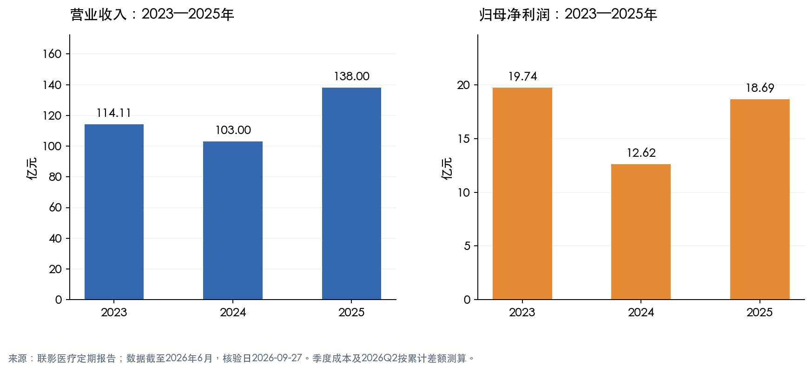
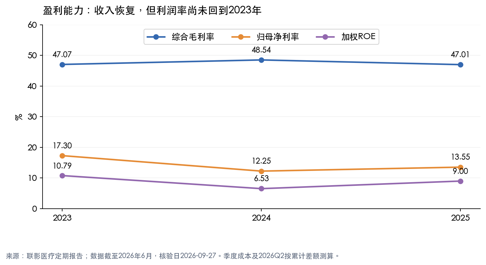
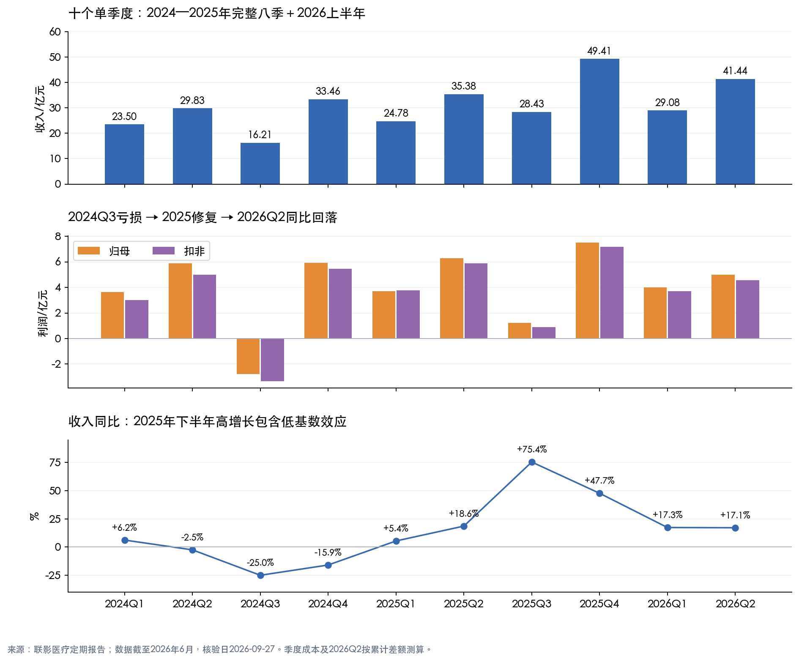
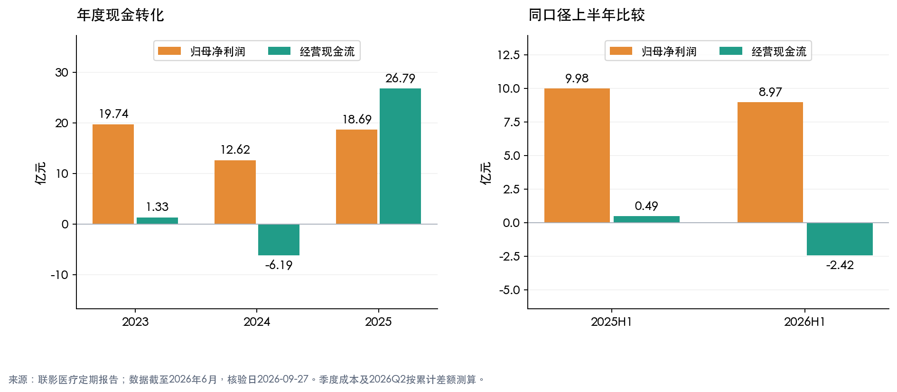
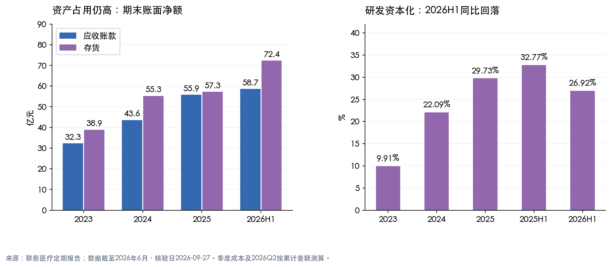
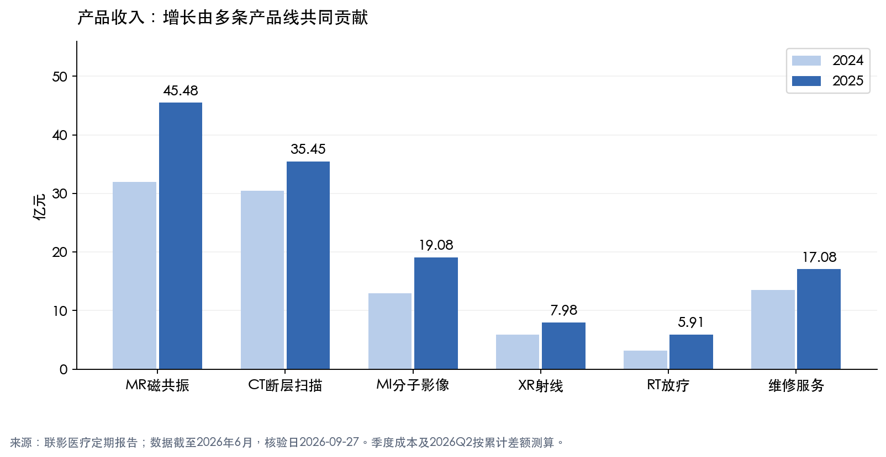

# 联影医疗：三年与季度财报趋势

核验日期：2026-09-27。证券代码：688271。最新财报：2026年半年报，未经审计；年度报告为审计口径。本报告聚焦经营与财务，不包含实时估值或买卖建议。

## 一、结论先行

**联影医疗呈现“2024年承压—2025年修复—2026上半年增收不增利”的轨迹。收入增长和海外拓展确实存在，但尚不能认定已经进入利润、现金流同步改善的稳定增长阶段。**

- 2025年收入138.00亿元、归母净利润18.69亿元，同比分别增长33.98%、48.14%；但归母利润仍比2023年低5.32%，两年收入复合增速约9.97%。低基数反弹不能直接外推为长期增速。
- 2025年扣非利润17.70亿元，超过2023年的16.65亿元；非经常性损益减少，修复并非主要靠一次性收益。但研发资本化比例从2023年的9.91%升至2025年的29.73%，仍需观察研发成果的商业转化。
- 2026H1收入增长17.22%，归母利润下降10.12%，扣非利润下降14.38%。测算Q2收入增长17.13%，扣非下降22.52%，盈利增速与收入继续分化。
- 2025年经营现金流改善至26.79亿元，约96%来自Q4；2026H1又转为净流出2.42亿元。年末回款改善是事实，但全年现金转化的稳定性仍待验证。

## 二、口径与原始资料

1. 年度覆盖2023—2025年；季度覆盖2024Q1—2025Q4完整八季，并补充2026Q1—Q2，共十季，因此也完整覆盖最近八季2024Q3—2026Q2。
2. 金额为人民币亿元，合并报表口径；“归母净利率”=归母净利润/收入，不与含少数股东损益的合并净利率混用。半年ROE不年化。
3. 2023—2025年各季度收入、归母、扣非及经营现金流直接取年报分季度表；2026Q1直接披露，2026Q2四项数据为半年报减一季报的**测算值**。
4. 季度毛利率为测算值：先将累计营业成本相减还原单季，再计算1－单季成本/单季收入。Q4为年报减前三季，不能用全年毛利率减前三季毛利率。
5. **质保费用重分类：**2024年报将保证类质保费用从销售费用转入营业成本，并将2023年成本由58.79亿元调整为60.39亿元，不影响净利润。年度使用重分类后值；2024季度成本采用2025对应季报、半年报、三季报比较列，避免使用2024原报告的旧成本口径。详见2024年报PDF第216页。
6. 负基数利润增长用“转亏/扭亏”，不展示误导性的增长率。同比优先于环比；医院设备交付、安装验收和年末回款存在季节性，Q2较Q1增长、Q4较Q3增长不等于趋势拐点。

原件和追溯入口：[原始财报清单](原始财报/来源与核验说明.md)、[原始金额JSON](原始数据/财务数据.json)、[完整数据核验表](原始数据/核验数据表.md)。各PDF逐页抽取文本保存在“原始数据”，并附SHA-256校验清单。

## 三、年度趋势：收入创新高，利润率尚未完全修复

|指标|2023|2024|2025|2025H1|2026H1|
|---|---:|---:|---:|---:|---:|
|营业收入|114.11|103.00|138.00|60.16|70.52|
|收入同比|23.52%|-9.73%|33.98%|12.79%|17.22%|
|归母净利润|19.74|12.62|18.69|9.98|8.97|
|归母同比|19.21%|-36.08%|48.14%|5.03%|-10.12%|
|扣非归母净利润|16.65|10.10|17.70|9.66|8.27|
|扣非同比|25.38%|-39.32%|75.18%|21.01%|-14.38%|
|综合毛利率|47.07%|48.54%|47.01%|47.93%|47.18%|
|归母净利率|17.30%|12.25%|13.55%|16.59%|12.72%|
|加权ROE|10.79%|6.53%|9.00%|4.90%|4.12%|
|经营现金流|1.33|-6.19|26.79|0.49|-2.42|
|研发投入|19.19|22.61|26.21|11.40|13.83|
|研发费用|17.29|17.61|18.42|7.66|10.11|
|研发资本化比例|9.91%|22.09%|29.73%|32.77%|26.92%|
|应收账款净额|32.28|43.59|55.90|50.80|58.67|
|存货净额|38.93|55.28|57.29|59.62|72.38|
|资产负债率|25.48%|29.00%|34.23%|27.52%|36.05%|

来源：2023年报第13—15页、2024年报第13—15/55/172—177/216页、2025年报第14—17/87/220—226页、2025半年报第9—10/58/132—139页、2026半年报第11—12/62/126—131页。资产负债项目为对应期末值，不是期间发生额。

**2024年：需求与费用共同挤压利润。**公司在年报中将压力归因于设备更新政策落地节奏、国内行业规模收缩、高端新品导入较长及持续研发和市场投入。毛利率并未下降，归母利润却下滑36%，说明问题不只是产品毛利，也涉及收入规模下降后的固定费用摊薄不足。2024销售费用18.23亿元、研发费用17.61亿元，相对收入分别达到17.70%、17.10%。这是公司解释与报表指标的相互印证，并非独立证明政策是唯一原因。

**2025年：修复真实，但主要不是毛利率扩张。**收入增长33.98%，成本增长37.97%，毛利率下降1.53个百分点；销售费用增长24.04%、研发费用仅增长4.57%，费用摊薄支撑利润。销售费用率降至16.39%，研发费用率降至13.35%。同时非经常性损益从2.52亿元降至0.99亿元，扣非增长快于归母，是较积极的信号。

**跨两年看更克制。**2025年收入较2023年增加20.94%，归母利润仍低5.32%；归母净利率由17.30%降至13.55%，ROE由10.79%降至9.00%。结论应是“业务规模扩大、利润修复不充分”，不是“盈利能力全面创新高”。

## 四、逐季度分析：2024—2025年与最新两季

单位：亿元。毛利率均为测算值；2026Q2金额亦为测算值。2024成本已统一至重分类后口径。

|季度|收入|归母|扣非|经营现金流|毛利率|收入同比|收入环比|
|---|---:|---:|---:|---:|---:|---:|---:|
|2024Q1|23.50|3.63|3.00|-6.57|49.57%|6.22%|-40.92%|
|2024Q2|29.83|5.87|4.98|0.32|48.93%|-2.47%|26.91%|
|2024Q3|16.21|-2.79|-3.34|-8.80|41.94%|-25.00%|-45.67%|
|2024Q4|33.46|5.91|5.46|8.86|50.67%|-15.90%|106.43%|
|2025Q1|24.78|3.70|3.79|-3.53|49.94%|5.42%|-25.94%|
|2025Q2|35.38|6.28|5.87|4.02|46.52%|18.60%|42.78%|
|2025Q3|28.43|1.22|0.88|0.58|45.09%|75.41%|-19.64%|
|2025Q4|49.41|7.49|7.17|25.72|47.00%|47.69%|73.81%|
|2026Q1|29.08|3.99|3.72|-9.59|47.16%|17.34%|-41.16%|
|2026Q2|41.44|4.98|4.55|7.17|47.19%|17.13%|42.53%|

|季度|归母同比|归母环比|扣非同比|扣非环比|
|---|---:|---:|---:|---:|
|2024Q1|10.20%|-60.08%|8.52%|-64.10%|
|2024Q2|-3.49%|61.55%|-2.47%|65.81%|
|2024Q3|转亏|转亏|转亏|转亏|
|2024Q4|-35.09%|扭亏|-34.67%|扭亏|
|2025Q1|1.87%|-37.35%|26.09%|-30.71%|
|2025Q2|6.99%|69.67%|17.96%|55.11%|
|2025Q3|扭亏|-80.54%|扭亏|-85.08%|
|2025Q4|26.81%|512.90%|31.19%|717.92%|
|2026Q1|7.78%|-46.75%|-1.75%|-48.11%|
|2026Q2|-20.67%|24.88%|-22.52%|22.32%|

### 2024年：下行主要集中在下半年

- **Q1：**收入与扣非分别增长6.22%、8.52%，尚未显示全面下滑；经营现金流净流出6.57亿元，盈利与回款不同步。
- **Q2：**收入、扣非分别下降2.47%、2.47%，增长开始停滞；环比增长主要不能排除季节性因素。
- **Q3：**收入下降25%，毛利率降至41.94%，扣非亏损3.34亿元。低收入规模、产品结构/成本变化与费用负担共同影响，不能仅归结为一次性非经常损益。该季研发投入6.18亿元，占收入38.11%。未取得足以量化每条产品线销量与单价贡献的季度披露，不作伪精确归因。
- **Q4：**恢复盈利并集中回款，但收入、扣非仍分别同比下降15.90%、34.67%；这是季节性恢复与同比疲弱并存，不是彻底反转。

### 2025年：修复加速，但季度利润仍不平滑

- **Q1：**扣非增长26.09%，归母仅增长1.87%；当季非经常性损益为-0.08亿元，上一年同期约+0.63亿元，解释了两类利润增速差异。
- **Q2：**收入增长18.60%，扣非增长17.96%，需求恢复更清晰；但毛利率同比下降约2.41个百分点至46.52%，需要费用效率对冲。
- **Q3：**收入增长75.41%、实现扭亏，改善明确，但比较基数是2024Q3低谷。扣非仅0.88亿元，约为收入3.08%，不能将高收入增速理解为高盈利能力。公司三季报解释为国内政策落地加快及海外业务稳步增长。
- **Q4：**收入49.41亿元，扣非7.17亿元，同比分别增长47.69%、31.19%；经营现金流25.72亿元，为全年约96%。相较Q3利润大增包含季节性及低基数，不能用Q4利润乘四作为正常全年盈利。

### 2026年：收入维持增长，二季度利润同比压力更大

- **Q1：**收入增长17.34%、归母增长7.78%，但扣非下降1.75%；经营现金流-9.59亿元，比上年同期-3.53亿元更弱，公司解释为采购及经营付款增加。
- **Q2：**收入41.44亿元、归母4.98亿元、扣非4.55亿元；同比为+17.13%、-20.67%、-22.52%。毛利率47.19%，较Q1仅提高约0.03个百分点；较上年Q2反而提高约0.67个百分点，说明该季利润下滑不能简单归因于毛利率恶化。
- Q2经营现金流7.17亿元，高于上年Q2的4.02亿元，是改善点；但不足以完全抵消Q1流出。与收入同步扩大的费用、汇兑与税负等影响，应结合半年累计利润桥分析，不把半年归因机械地全部分配给Q2。

## 五、2026H1利润为什么下滑：不只是汇率

与2025H1相比，收入增加10.36亿元，毛利增加约4.44亿元，但以下税前项目抵消了大部分增量：

|税前利润影响项|同比变化/亿元|说明|
|---|---:|---|
|毛利增加|+4.44|收入增长抵消毛利率小幅下滑|
|销售费用增加|-1.07|增速11.41%，低于收入增长，费用率反而下降|
|管理费用增加|-0.54|折旧及股份支付等增加|
|研发费用增加|-2.44|增速31.86%，费用率由12.74%升至14.33%|
|财务费用增加|-1.46|由净收益0.50亿元转为净支出0.96亿元|
|其中汇兑同比不利变化|-1.33|已包含在上一行，不能重复扣除|
|其他收益增加|+0.80|包含补助、退税等，应查附注，不等同全为非经常损益|
|信用减值损失增加|-0.33|应收规模与信用风险需持续跟踪|
|其余净项|约+0.21|税金、公允价值、投资、资产减值及营业外等合计|
|利润总额净变化|-0.40|10.73亿元降至10.33亿元|

所得税费用又由0.85亿元升至1.44亿元，有效税率约7.93%升至13.94%，进一步压低税后利润；少数股东损益差异后，归母利润减少约1.01亿元。

**事实与管理层调整口径的边界：**半年报说明，剔除汇兑损益后利润总额同比增长8.79%，但这是税前调整口径，不能替代归母净利润或扣非净利润。海外经营带来的汇率风险会持续存在，也不能假设未来汇兑损失必然消失。

**研发资本化是关键解释变量。**2025H1资本化研发3.74亿元，2026H1约3.72亿元，基本不变；新增研发主要进入费用，资本化比例从32.77%降至26.92%。因此2026利润承压部分来自更高的当期费用化投入，而2025利润改善则受益于费用化研发增速低于总投入增速。符合条件的资本化并不等于不当会计，但会把成本推迟至未来摊销；不要把资本化金额直接当作“虚增净利润”扣减，税率、历史摊销等口径并不等同。

## 六、现金流与资产负债表交叉验证

1. **2023—2024年现金转化较弱。**两年经营现金流合计-4.87亿元，归母利润合计32.36亿元，利润没有充分变成经营现金。2025改善值得肯定，但2023—2025合计经营现金流21.93亿元，对应归母利润51.05亿元，累计转化约43%。分母为归母利润的近似观察指标，严格现金转化也应看含少数股东的合并净利润。
2. **2024年资产占用明显恶化。**收入下降9.73%，应收账款增长35.05%、存货增长41.99%。2025应收增长28.25%、存货增长3.63%，均慢于收入33.98%，显示一定改善。
3. **2026H1不能错用年初比。**与2025年6月末同口径比较，应收账款增长约15.48%，略低于收入17.22%；存货增长约21.40%，高于收入和营业成本18.90%的增速。与年初比较，存货增加15.09亿元、26.34%，但这一年初比不能直接与收入同比并列判定恶化。
4. **现金减少不全是回款变差。**2026H1销售收现72.77亿元，较61.79亿元增长约17.77%，与收入基本匹配；经营净流出主要还要考虑采购、人员、税费及其他经营支出。Q2回款改善，但库存占用和持续投入仍压制累计现金流。
5. **账面现金增加不是经营现金流改善。**2026H1货币资金升至72.32亿元，但交易性金融资产由49.27亿元降至17.17亿元，两者合计从104.29亿元降至89.49亿元。理财赎回改变资产形态，不能被当成新增盈利。
6. **负债率上升，但不等于立即存在偿债危机。**2026H1资产负债率36.05%，短期借款15.25亿元；还应关注货币资金受限情况、客户预收及经营负债结构。应付账款由23.49亿元升至32.48亿元，提供现金流缓冲；合同负债由29.75亿元降至26.54亿元，不应只看收现或账面现金一个指标。

## 七、业务结构：多产品线增长，海外与服务是积极因素

|产品/业务|2024收入/亿元|2025收入/亿元|2025同比|
|---|---:|---:|---:|
|MR磁共振|31.92|45.48|42.46%|
|CT断层扫描|30.48|35.45|16.31%|
|MI分子影像|12.99|19.08|46.86%|
|XR射线|5.87|7.98|35.98%|
|RT放疗|3.19|5.91|85.52%|
|维修服务|13.56|17.08|25.96%|

来源：2025年报第96—98页。表格不含软件及其他业务，不能加总为全部营业收入。

- 2025年设备收入113.90亿元，毛利率46.56%；维修服务收入17.08亿元，毛利率61.86%。服务毛利约10.57亿元，占主营毛利约16.5%，有助于降低对新增设备订单的依赖，但尚未成为主要收入来源。上述为毛利贡献，不是净利润贡献。
- 2025年境内、境外**主营**收入分别97.60、33.93亿元，同比分别增长27.35%、52.81%；对应主营毛利率49.30%、46.64%。不能直接断言海外收入增长必然拉高公司整体毛利率。
- 2026H1地区披露为**全部营业收入**：境内52.87亿元、海外17.65亿元，海外占比25.02%；公司披露同比增速分别8.49%、54.46%。这与上一条2025年主营地区口径不同，不混算占比变化。
- 2026H1设备收入58.51亿元、维修服务9.80亿元；服务占全部收入13.90%。公司披露服务收入同比增长20.11%。海外与服务增长支撑收入，但尚不足以完全抵消费用、汇率与税负对净利润的影响。
- 年报第98页披露2025年CT/MR/XR/MI/RT销量分别增长7.37%/13.50%/13.15%/31.58%/50.00%，均低于对应收入增速。以收入增速除以销量增速测算，MR平均每台收入约增长25.52%，CT约增长8.33%；这是型号、配置和区域结构共同作用的混合单价，不等于同型号提价。未完整取得各季度可比型号量价数据，不把年度结构变化机械分摊到各季。

## 八、下一期验证清单与判断边界

|观察项目|改善信号|需要警惕|
|---|---|---|
|单季扣非利润|同比恢复增长，且快于收入|收入保持增长但扣非继续下降|
|毛利率与费用率|毛利稳定，费用率自然摊薄|靠提高资本化比例支撑利润，研发商业化滞后|
|现金流|前三季累计现金流改善，不仅依赖Q4|利润增长、经营现金持续净流出|
|应收与存货|同季同比增速不持续超过收入/成本|账龄拉长、存货积压、减值增加|
|海外及服务|收入增长同时带来毛利、现金贡献|汇兑损失、交付延迟或回款风险扩大|

**趋势事实：**业务规模扩大，2025年从低谷恢复，2026H1收入继续增长而利润回落。

**分析判断：**当前更接近“收入扩张、投入及资金占用仍高”的阶段，而非已经验证的高质量稳定复利阶段。2025年恢复并非虚假，但仅凭年度利润增长判断盈利拐点，容易忽略2026Q2的压力。

**未来假设：**如果海外与服务维持增长、研发成果转化为收入、费用率下降且现金转化改善，利润有可能重新跟上收入；若国内招采/验收延迟、竞争压价或汇率风险增加，则可能继续增收不增利。以上是条件推演，不是盈利预测。

财报分析可支持经营判断，但不能单独回答股票贵不贵；未在本报告中使用股价、目标价或给出仓位建议。
