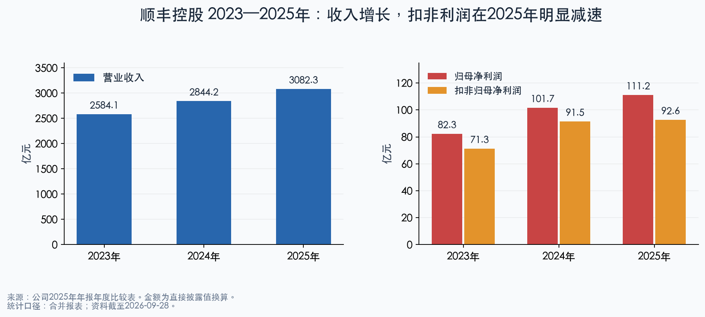
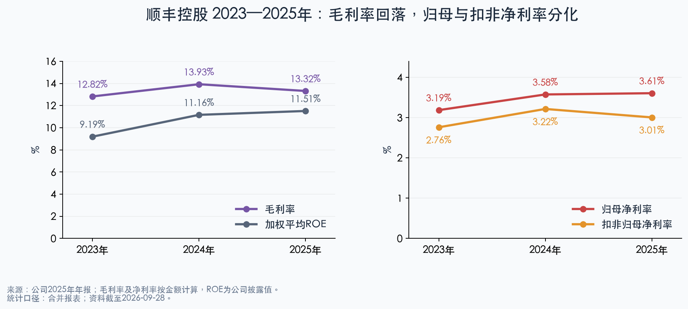
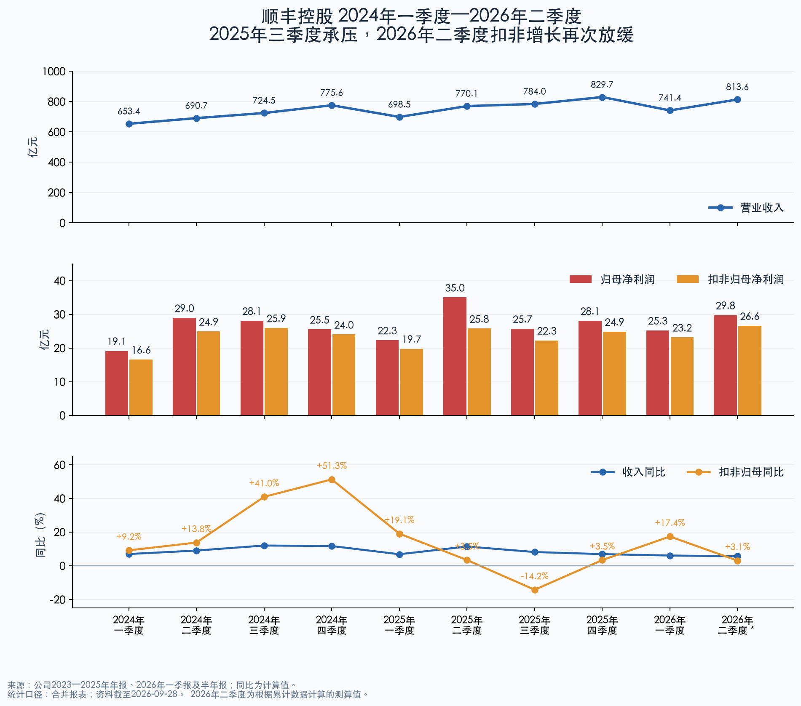
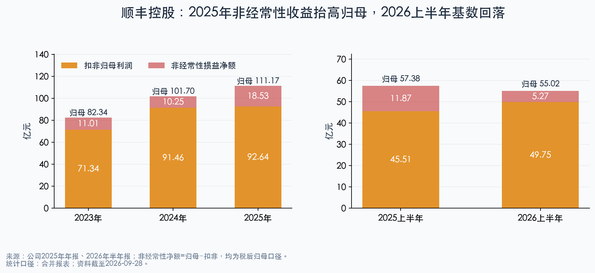
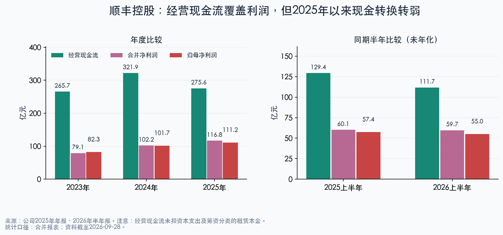
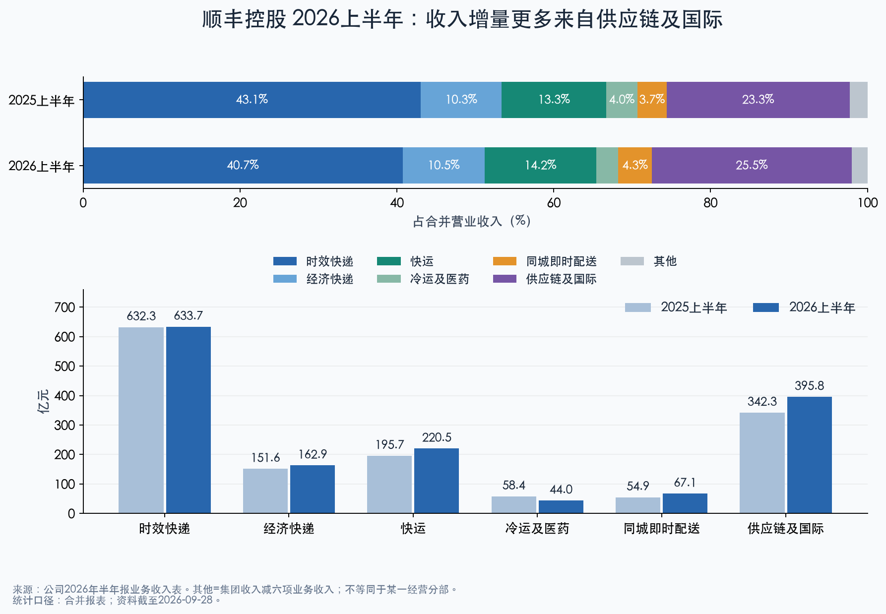

# 顺丰控股：2023—2025年财报趋势与2024—2026年上半年季度分析

资料检索截至：2026年9月28日。最新财务报告期：2026年6月30日。证券代码：002352.SZ / 06936.HK。

## 核心判断

**顺丰过去三年经历了“2023—2024年盈利修复、2025年规模增长但核心利润承压、2026年上半年扣非修复但二季度放缓”的过程。** 不能只凭收入和归母利润的新高认定经营质量持续上行，也不能仅凭2026年上半年归母利润下降认定主营业务衰退。

- **趋势事实：** 2023—2025年收入由2,584.09亿元升至3,082.27亿元，归母利润由82.34亿元升至111.17亿元；但2025年扣非利润仅增长1.29%，毛利率下降0.61个百分点，经营现金流下降14.39%。
- **原因判断：** 2025年拓展市场、调整业务结构及战略投入压低毛利率；资产处置等非经常性损益，以及费用与所得税变化，支撑了表面利润增长。2026年上半年扣非同比增长9.32%，表明核心盈利有所修复，但二季度扣非增速已经降至3.11%。
- **未来假设：** 如果价格和业务结构改善足以抵消燃油及网络投入，并且回款跟上，修复才可能持续。上述条件尚需下一期验证，不能直接年化上半年或外推一季度增速。

## 一、范围、口径和计算规则

“最近两年”采用2024、2025两个完整年度的八个季度，并补充2026Q1、Q2，共10个季度；最近连续八季为2024Q3—2026Q2。

1. 采用公司合并报表、中国会计准则口径；金额由原文“千元”除以100,000换成“亿元”。扣非利润均指扣非归母净利润。
2. 2023—2025单季度收入、毛利、利润和经营现金流直接取年报“分季度主要财务指标/数据”，不是自行用累计数还原；2023季度作为同比和环比基数保留在数据附录。
3. 2026Q1来自一季报；2026Q2全部金额为**测算值**：半年累计减一季度。毛利先由收入减营业成本计算，再相减；季度毛利率=单季毛利/单季收入，不能用两个累计毛利率相减。
4. 同比=当季/上年同季−1；环比=当季/前一季−1；利润率差使用百分点。所有比率按未四舍五入金额计算。
5. “合并净利率”含少数股东损益；“归母净利率”不含。ROE采用公司披露加权平均值，半年值未年化，不能直接与全年比较。半年流量与全年仅作列示，不作同长度增长比较；资产负债数据均为期末余额。
6. 春节、旺季、生鲜季节性、国际运价和合并范围变化均影响比较；季度同比通常比环比更适合判断趋势。公司原因说明属于管理层解释，不等同于已识别的独立因果贡献。

## 二、近三年年度趋势与最新半年报

| 指标（金额：亿元） | 2023年 | 2024年 | 2025年 | 2026上半年 |
| --- | --- | --- | --- | --- |
| 营业收入 | 2,584.09 | 2,844.20 | 3,082.27 | 1,555.06 |
| 归母净利润 | 82.34 | 101.70 | 111.17 | 55.02 |
| 扣非归母净利润 | 71.34 | 91.46 | 92.64 | 49.75 |
| 毛利率（计算值） | 12.82% | 13.93% | 13.32% | 13.45% |
| 合并净利率（计算值） | 3.06% | 3.59% | 3.79% | 3.84% |
| 归母净利率（计算值） | 3.19% | 3.58% | 3.61% | 3.54% |
| 扣非归母净利率（计算值） | 2.76% | 3.22% | 3.01% | 3.20% |
| 经营现金流净额 | 265.70 | 321.86 | 275.55 | 111.71 |
| 研发投入 | 33.63 | 30.94 | 29.60 | 14.48 |
| 其中：研发费用 | 22.85 | 25.34 | 21.70 | 10.82 |
| 其中：资本化研发投入 | 10.78 | 5.60 | 7.90 | 3.66 |
| 研发资本化率（计算值） | 32.05% | 18.10% | 26.69% | 25.25% |
| 加权平均ROE（期内、未年化） | 9.19% | 11.16% | 11.51% | 5.49% |
| 期末资产负债率 | 53.37% | 52.14% | 49.03% | 50.08% |
| 期末应收账款净额 | 251.33 | 277.15 | 306.07 | 323.23 |
| 期末合同资产 | 16.33 | 27.41 | 30.49 | 30.78 |
| 期末存货净额 | 24.40 | 24.32 | 30.39 | 29.99 |
| 经营现金流/合并净利润（计算值） | 3.36倍 | 3.15倍 | 2.36倍 | 1.87倍 |

来源：S1—S3、S6。2026H1资本化研发投入=研发投入−研发费用，为测算值；其他计算指标已在行名标识。研发投入与利润表研发费用不是同一口径。

2024年收入增长10.07%、归母增长23.51%、扣非增长28.20%，是盈利改善较扎实的一年。2025年三项增速降至8.37%、9.31%、1.29%，收入扩张与核心利润增长明显脱节。2023—2025两年复合增速分别约9.21%、16.19%、13.96%，这些平均数掩盖了2025年的减速。

2023年本身收入同比下降3.39%，归母和扣非却分别增长33.38%、33.67%。结合公司分部数据，这一年供应链及国际分部收入下降30.09%，速运及大件分部利润增长54.62%，说明业务结构及国内经营效率对盈利改善的影响超过总收入变化。2023年出售丰网也改变比较范围。不能把2023年低收入基数完全视为需求自然增长空间。

2024年毛利率由12.82%升至13.93%，2025年回落至13.32%；2025年归母净利率仍微升至3.61%，但扣非净利率由3.22%降至3.01%。**毛利率和扣非净利率共同转弱，比归母净利率的小幅改善更能说明主营压力。**

费用率也不能只看单项。2023/2024/2025年销售费用率为1.16%/1.09%/1.27%，管理费用率为6.82%/6.52%/6.33%，研发费用率为0.88%/0.89%/0.70%，财务费用率为0.72%/0.65%/0.58%。2025年销售投入加强，管理效率改善，但研发费用降低同时受到资本化率从18.10%升至26.69%的影响：研发投入只下降4.33%，研发费用下降14.36%，资本化金额增加2.30亿元。因此，不能把研发费用减少全部归因于效率提升，也不能直接把资本化增加额视为同额净利润增厚。

## 三、按季度看拐点：2024—2025全年，并补充2026上半年

金额单位：亿元。＊为根据累计数据计算的测算值。毛利率均为计算值。

| 单季度 | 收入 | 归母 | 扣非归母 | 毛利率 | 经营现金流 |
| --- | --- | --- | --- | --- | --- |
| 2024年1季度 | 653.41 | 19.12 | 16.57 | 13.17% | 47.34 |
| 2024年2季度 | 690.69 | 28.95 | 24.91 | 14.51% | 89.88 |
| 2024年3季度 | 724.51 | 28.10 | 25.95 | 14.14% | 88.30 |
| 2024年4季度 | 775.59 | 25.53 | 24.03 | 13.85% | 96.34 |
| 2025年1季度 | 698.50 | 22.34 | 19.74 | 13.30% | 40.62 |
| 2025年2季度 | 770.08 | 35.04 | 25.77 | 13.14% | 88.75 |
| 2025年3季度 | 784.03 | 25.71 | 22.27 | 12.49% | 64.79 |
| 2025年4季度 | 829.66 | 28.09 | 24.86 | 14.28% | 81.40 |
| 2026年1季度 | 741.42 | 25.26 | 23.17 | 13.74% | 33.65 |
| 2026年2季度＊ | 813.64 | 29.76 | 26.58 | 13.18% | 78.06 |

来源：S2、S3、S5、S6。2026Q2测算：收入813.64300亿元，毛利107.27127亿元，归母29.76177亿元，扣非26.57608亿元，经营现金流78.06475亿元。

| 单季度 | 收入同比 | 收入环比 | 归母同比 | 归母环比 | 扣非同比 | 扣非环比 | 毛利率同比(pp) | 毛利率环比(pp) |
| --- | --- | --- | --- | --- | --- | --- | --- | --- |
| 2024年1季度 | 7.03% | -5.85% | 11.14% | -2.96% | 9.21% | 4.35% | -0.69 | +0.80 |
| 2024年2季度 | 9.08% | 5.70% | 17.87% | 51.45% | 13.84% | 50.35% | +1.32 | +1.34 |
| 2024年3季度 | 12.07% | 4.90% | 34.59% | -2.92% | 40.98% | 4.16% | +2.16 | -0.37 |
| 2024年4季度 | 11.76% | 7.05% | 29.61% | -9.15% | 51.32% | -7.40% | +1.48 | -0.29 |
| 2025年1季度 | 6.90% | -9.94% | 16.87% | -12.50% | 19.12% | -17.86% | +0.13 | -0.55 |
| 2025年2季度 | 11.50% | 10.25% | 21.02% | 56.81% | 3.46% | 30.59% | -1.37 | -0.15 |
| 2025年3季度 | 8.21% | 1.81% | -8.53% | -26.63% | -14.17% | -13.59% | -1.65 | -0.65 |
| 2025年4季度 | 6.97% | 5.82% | 10.01% | 9.27% | 3.46% | 11.62% | +0.43 | +1.79 |
| 2026年1季度 | 6.14% | -10.64% | 13.05% | -10.08% | 17.42% | -6.78% | +0.44 | -0.54 |
| 2026年2季度＊ | 5.66% | 9.74% | -15.05% | 17.83% | 3.11% | 14.68% | +0.04 | -0.55 |

同比和环比均为计算值；2024年增长基数来自S1。pp=百分点。

| 季度 | 趋势事实 | 原因判断及解读 |
| --- | --- | --- |
| 2024Q1 | 收入+7.03%，扣非+9.21%，毛利率13.17%，同比下降约0.69个百分点 | 开年利润温和增长；毛利承压而净利增长，费用控制起到支撑。丰网出售影响收入可比性，不能将全部增长直接视为同口径量价改善。 |
| 2024Q2 | 收入+9.08%，扣非+13.84%，毛利率升至14.51% | 环比改善明显，但二季度季节性优于春节季度；同比才表明盈利确有改善，不宜单看环比利润跃升。 |
| 2024Q3 | 收入+12.07%，扣非+40.98%，毛利率14.14% | 同比利润弹性最突出，既有上年较低毛利率基数，也与年报所述规模效应和网络降本一致。毛利率较Q2稍降，未呈逐季单向上升。 |
| 2024Q4 | 收入+11.76%，扣非+51.32%，但扣非环比下降7.40% | 旺季收入高而利润环比回落；高同比有2023Q4低基数帮助，不能将51%的增长直接外推。 |
| 2025Q1 | 收入+6.90%，扣非+19.12%，毛利率13.30% | 公司披露总件量增长19.7%，收入增长较慢；混合产品结构影响票均收入，不能等同于同产品降价。毛利率同比略升，开年修复尚可。 |
| 2025Q2 | 收入+11.50%，归母+21.02%，扣非仅+3.46%；毛利率13.14% | REIT相关股权处置税后收益约5.9亿元抬高归母。归母35.04亿元与扣非25.77亿元差额9.26亿元，不应全部视为经常性赚钱能力。 |
| 2025Q3 | 收入+8.21%，归母−8.53%，扣非−14.17%，毛利率12.49% | 公司披露件量+33.4%、速运物流收入+14.4%、供应链及国际收入−5.3%。市场拓展、资源投入及海运价格回落共同施压，量增明显快于收入增长，盈利转弱是全年主要拐点。 |
| 2025Q4 | 收入+6.97%，归母+10.01%，扣非+3.46%；毛利率14.28% | 扣非环比+11.62%，毛利率回升，显示策略调优开始见效；但季度旺季与同比低个位数扣非增长限制了修复强度判断。 |
| 2026Q1 | 收入+6.14%，归母+13.05%，扣非+17.42%；毛利率13.74% | 公司披露件量+4.9%，速运物流单票收入回升，强调价值经营及资源分层。毛利率同比提升0.44个百分点，改善较2025Q1扎实；经营现金流同比却下降17.16%。 |
| 2026Q2＊ | 收入+5.66%，归母−15.05%，扣非+3.11%；毛利率13.18% | 归母下降主要受去年处置收益基数影响。扣非仍增长，但较Q1明显放缓；毛利率同比仅改善约0.04个百分点、环比下降0.55个百分点，与公司披露Q2油价及运力成本上行压力相一致，不能据此量化油价独立影响。 |

以上业务原因主要来自S1—S7的管理层讨论；2024Q2、Q4等未单独披露详细量价成本归因的季度，以财务变化和全年说明提出判断，不虚构季度因素贡献。

## 四、利润质量：把归母、扣非和现金流一起看

2023/2024/2025年归母与扣非差额分别为11.01/10.25/18.53亿元，占归母约13.37%/10.08%/16.67%。2025年归母增加9.47亿元，其中非经常性损益净额增加8.29亿元，占归母增量约87.5%；这是一项**算术拆分**，不代表扣非已完全排除所有非持续因素。

2025年非经常性项目中，处置子公司投资收益7.93亿元、计入非经常性损益的政府补助6.80亿元、相关金融资产及负债损益6.97亿元，均为税前分类金额，不能直接与税后归母相加。处置子公司收益包含公司披露的REIT相关税后约5.9亿元。2025年利润表投资收益14.68亿元、公允价值变动收益0.71亿元，信用及资产减值损失合计2.38亿元，2024年两类减值合计6.01亿元；减值压力下降也改善了利润比较基数，未来不保证继续下降。

2026H1归母55.02亿元，同比下降4.11%，扣非49.75亿元，同比增长9.32%；非经常性损益由2025H1的11.87亿元降至5.27亿元，减少6.60亿元，超过扣非增加的4.24亿元。因此，上半年归母下降主要源于非经常性收益减少。2026H1信用减值由上年同期转回1.17亿元变为损失1.65亿元，进一步提示需关注回款与信用成本。来源：S3、S6。

经营现金流绝对额仍明显高于利润，但**这种覆盖不能直接等同于盈利质量持续改善**。顺丰折旧摊销较大，租赁本金等现金支出又列于筹资活动，经营现金流天然可能显著高于净利润。2025年经营现金流/合并净利润由3.15倍降至2.36倍；2026H1为1.87倍，上年同期为2.15倍。

现金流附注提供了比“利润增长”更清楚的警示：

| 现金流调节项目（亿元；负数为占用现金） | 2024年 | 2025年 | 2025H1 | 2026H1 |
| --- | ---: | ---: | ---: | ---: |
| 经营性应收项目增加 | -2.47 | -48.76 | -20.58 | -39.81 |
| 经营性应付项目增加 | 27.42 | 42.97 | 9.03 | 7.92 |
| 存货变化的现金影响 | 0.08 | -6.05 | 1.06 | 0.39 |
| 经营现金流净额 | 321.86 | 275.55 | 129.37 | 111.71 |

来源：S3财务附注四(57)(a)、S6附注四(50)(a)。经营性应收项目包括多种往来，不等同于资产负债表单项应收账款。2025年应收占用同比多46.29亿元，2026H1又同比多19.23亿元；2025年应付增加有部分对冲，仍未阻止现金流下降。公司解释2025年受税费支付及业务结构变化带来的结算节奏影响；是否只是时间错位，需靠后续回款验证。

资产负债表也有对应变化：2025年应收账款净额增长10.44%、合同资产增长11.25%、存货增长24.94%，都快于收入8.37%的增长；其中存货仅占总资产约1.4%，不是制造业式的大额库存危机，但持续累积仍占用现金。应收账款加合同资产/全年收入由2023年的10.36%升至2024年的10.71%、2025年的10.92%（计算值），是应持续跟踪的信号。2026H1应收较年初增长5.61%，此为半年期末变动，不与半年收入同比增幅直接作同口径比较。

公司披露自由现金流2023/2024/2025年为131.06/222.98/179.33亿元，2025年下降19.57%，定义为经营现金流减资本支出（不含股权投资）。2026H1购建固定资产及其他长期资产付现60.83亿元，上年同期41.38亿元；简单“经营现金流−该项付现”由87.99亿元降至50.88亿元，**这不是公司完整自由现金流口径，也未扣股权投资及租赁本金**，只用于显示资本支出现金压力。

资本结构在2025年改善，资产负债率由53.37%降至49.03%；2026H1回升至50.08%。短期借款从2025年末70.13亿元升至172.54亿元，公司解释为认购极兔股份的过桥贷款。应将此项投资融资与主营经营现金流分别理解，并跟踪后续融资置换与回款，而非将短期借款增长直接认定为主营亏损。来源：S3、S6。

## 五、增长来自哪里，利润由谁贡献

| 业务收入（亿元） | 2024年 | 2025年 | 2025同比 | 2025H1 | 2026H1 | 2026H1同比 |
| --- | ---: | ---: | ---: | ---: | ---: | ---: |
| 时效快递 | 1,222.06 | 1,310.48 | 7.24% | 632.33 | 633.65 | 0.21% |
| 经济快递 | 272.51 | 320.53 | 17.62% | 151.60 | 162.94 | 7.47% |
| 快运 | 376.41 | 421.34 | 11.94% | 195.73 | 220.48 | 12.65% |
| 冷运及医药 | 98.12 | 106.06 | 8.09% | 58.37 | 43.97 | -24.67% |
| 同城即时配送 | 88.73 | 127.19 | 43.35% | 54.93 | 67.09 | 22.13% |
| 供应链及国际 | 704.92 | 729.39 | 3.47% | 342.34 | 395.78 | 15.61% |

以上为业务收入，不含对应分部“其他”及未分配收入，不能直接相加为合并总收入。来源：S3、S6。

2026H1时效快递占合并收入约40.75%，收入几乎持平；供应链及国际业务占比由23.31%升至25.45%，贡献新增收入约53.44亿元，约占集团收入增量的61.8%（按业务收入增量计算）。快运与同城增长补位；冷运及医药下降，公司解释主要是气候影响部分中高端时令鲜果产量。这些数据表明增长来源在变化，不能将集团5.89%的增长理解为各业务全面景气。

| 分部净利润（亿元，合并分部口径） | 2024年可比口径 | 2025年 | 2025H1可比口径 | 2026H1 |
| --- | ---: | ---: | ---: | ---: |
| 速运及大件 | 109.81 | 106.01 | 53.85 | 55.74 |
| 同城即时配送 | 1.32 | 2.78 | 1.37 | 3.49 |
| 供应链及国际 | -7.62 | 1.88 | -0.08 | 0.30 |
| 未分配部分 | -1.67 | 6.47 | 5.55 | 0.66 |

来源：S3、S6。分部利润并非归母利润，包含少数股东因素；还存在分部间抵消，表内不能直接相加为合并或归母利润。2025年起将并购KLN融资利息划入未分配部分，2024年及2025H1比较数采用新报告重述后的口径，避免将旧报告数直接拼接。

**收入增长的新业务还没有替代速运及大件的利润支柱。** 2025年速运及大件利润下降3.46%，2026H1增长3.52%；供应链及国际虽然营收增速较快，但2026H1分部利润仅0.30亿元。后者分部净利率按分部对外收入粗算约0.07%，是观察盈利兑现的重点。该粗算不是公司披露的分部毛利率，受分部费用分配和抵消影响。

同城分部2026H1净利润增长154.91%，高于收入增速；公司同时披露投资收益增加，不能将其全部解释为经营杠杆。国际分部改善包括KEX减亏，而国际货代又受运价波动影响，必须拆开运价驱动收入与物流服务能力带来的收入。

地域上，2025年中国内地收入2,668.18亿元，同比增长9.89%；中国港澳台98.62亿元，同比增长4.17%；海外315.46亿元，同比下降1.90%。因此，“供应链及国际业务增长”与“海外地区收入增长”不是同一指标，不能混用。公开报告未按上述每个业务同时给出独立毛利率和完整利润，故不把集团毛利率分摊为各产品毛利率。来源：S3。

## 六、下一期需要验证什么

| 核验点 | 支持持续改善的证据 | 提示修复不足的证据 |
| --- | --- | --- |
| 核心盈利 | 单季扣非增速重新快于收入，并有毛利率同比改善 | 扣非延续低个位数增长或转负，收入仍靠低利润增量 |
| 量价与结构 | 时效收入恢复、速运票均收入改善且高价值客户留存 | 总件量增长但收入/毛利没有跟上；核心时效持续停滞 |
| 现金回收 | 经营现金流同比回升，经营性应收占用减少 | 应收、合同资产增长持续超过同口径收入增长 |
| 成本 | 油价和运力成本压力被网络效率及价格消化 | 费用率上升叠加毛利率下滑，研发资本化继续掩盖费用趋势 |
| 国际业务 | 分部净利润和净利率有实质提高 | 收入扩张但盈利仍接近盈亏平衡，运价回落即受压 |
| 投资与融资 | 资本支出对应利用率、回款和回报兑现，过桥融资妥善置换 | 投资及营运资金持续占用，现金转换继续变弱 |

这些是观察条件，不是盈利预测。2026Q3截至研究日尚未结束，本报告不填入未披露季度数据，也不将月度经营简报当成利润表。

## 七、原始季度金额与复核方式

下表保留报告直接披露/还原的原始千元金额。2023季度用于核验同比基数；2026Q2为测算。研发与资产项目的原始金额及来源另存同目录JSON；分部数据保留于正文表格，图表使用同一份数据。

| 期间 | 收入（千元） | 毛利（千元） | 归母（千元） | 扣非（千元） | 经营现金流（千元） |
| --- | --- | --- | --- | --- | --- |
| 2023Q1 | 61048078 | 8459668 | 1720058 | 1517130 | 4305202 |
| 2023Q2 | 63317520 | 8350650 | 2456224 | 2188179 | 9519625 |
| 2023Q3 | 64646001 | 7742263 | 2088176 | 1840603 | 7151267 |
| 2023Q4 | 69397804 | 8582989 | 1970035 | 1587818 | 5593725 |
| 2024Q1 | 65341051 | 8602991 | 1911636 | 1656846 | 4734437 |
| 2024Q2 | 69068669 | 10021957 | 2895078 | 2491124 | 8987832 |
| 2024Q3 | 72451273 | 10242675 | 2810406 | 2594798 | 8830069 |
| 2024Q4 | 77559066 | 10742649 | 2553307 | 2402738 | 9634035 |
| 2025Q1 | 69849924 | 9288250 | 2234197 | 1973620 | 4061813 |
| 2025Q2 | 77008250 | 10121950 | 3503502 | 2577367 | 8874877 |
| 2025Q3 | 78402808 | 9793178 | 2570557 | 2227033 | 6478524 |
| 2025Q4 | 82965665 | 11844993 | 2808960 | 2485766 | 8140061 |
| 2026Q1 | 74142121 | 10185361 | 2525728 | 2317341 | 3364929 |
| 2026Q2 | 81364300 | 10727127 | 2976177 | 2657608 | 7806475 |

复核：2023—2025每年四季度之和分别与年报年度收入、毛利、归母、扣非和经营现金流一致；2026Q1+Q2与半年报五项金额一致。2026Q2的变化率使用2025Q2直接披露值和2026Q1直接披露值计算。图表及正文展示的舍入数可能有尾差。

## 资料来源

- **S1** [2023年年度报告](https://money.finance.sina.com.cn/corp/view/vCB_AllBulletinDetail.php?id=9901153&stockid=002352)：2023年度、2023年季度同比基数；第二节及管理层讨论。
- **S2** [2024年年度报告](https://vip.stock.finance.sina.com.cn/corp/view/vCB_AllBulletinDetail.php?id=10823716)：2024季度直接披露值、2023—2024研发与资产数据；第二节、第四节、第十一节。
- **S3** [2025年年度报告](https://money.finance.sina.com.cn/corp/view/vCB_AllBulletinDetail.php?id=12042946&stockid=002352)：PDF第14—16页年度及季度、非经常性损益；管理层讨论、财务附注；PDF第241页现金流调节。
- **S4** [2025年第三季度报告](https://ir.sf-express.com/media/xojfjp4h/%E9%A1%BA%E4%B8%B0%E6%8E%A7%E8%82%A1-2025%E5%B9%B4%E4%B8%89%E5%AD%A3%E5%BA%A6%E6%8A%A5%E5%91%8A.pdf)：2025Q3业务量、收入、毛利与原因说明，PDF第2—5页。
- **S5** [2026年第一季度报告](https://static.cninfo.com.cn/finalpage/2026-04-29/1225231842.PDF)：2026Q1直接披露；第2—5页及合并利润表。
- **S6** [2026年半年度报告](https://money.finance.sina.com.cn/corp/view/vCB_AllBulletinDetail.php?id=12570675&stockid=002352)：2026H1与2025H1比较数据；财务摘要、管理层讨论；PDF第162页现金流调节。
- **S7** [2025年第一季度报告](https://static.cninfo.com.cn/finalpage/2025-04-29/1223367388.PDF)：2025Q1量价及经营原因。

资料均为公司公开定期报告原文，部分通过新浪公告镜像获取；2025年报、2026半年报及季度报告已下载PDF交叉核验。来源检索截至2026-09-28，财务数据截至2026-06-30；本报告为财务研究，不包含股价估值或买卖时点判断。
